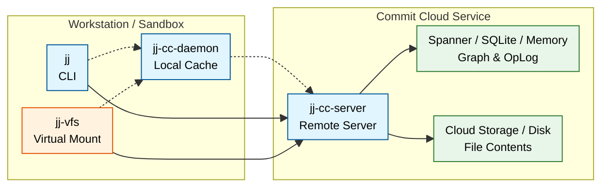

# jj-commit-cloud

jj-commit-cloud is a cloud-backed repository storage system for [jj](https://github.com/jj-vcs/jj) (Jujutsu). Standard jj stores a repository's commits, directory trees, file contents, and operation log on one machine inside `.git/` and `.jj/`. jj-commit-cloud moves that repository state into a [shared remote service](server/), letting developers, cloud IDEs, and parallel coding agents open, inspect, and evolve repositories across workstations, cloud VMs, and ephemeral sandboxes without cloning packfiles onto every disk or contending on local `.lock` files.

Because upstream jj separates its version control library (`jj_lib`) from physical storage traits, the [Commit Cloud CLI](cli/) embeds upstream jj's command runner alongside [remote storage backends](lib/). Everyday commands (`jj status`, `jj diff`, `jj new`, `jj describe`, `jj rebase`, `jj squash`, `jj op log`, `jj undo`) work the same way in a cloud-backed workspace as in a local checkout, while pairing with [jj-vfs](https://github.com/jj-vcs/jj-vfs) for on-demand virtual checkouts.

## Why Commit Cloud

Local version control stores an entire repository inside a `.git/` directory on one disk. That model works well for a single checkout on one laptop, yet runs into three bottlenecks as repositories grow and as developers, cloud IDEs, and coding agents work in parallel:

* **Repeated Clones Across Machines and Sandboxes:** Every new workstation, CI job, or short-lived agent sandbox must download gigabytes of packfiles onto local disk before reading a single file or authoring a commit.
* **Lock Contention and Blocking Conflicts:** Concurrent processes sharing a checkout contend on `.git/index.lock` and reference locks, while merge conflicts write conflict markers onto disk and halt rebases mid-stack until resolved interactively.
* **Machine-Bound Work in Progress:** Unpushed commits, working-copy edits, and undo history exist only on the machine where they were created, forcing users and agents to push temporary branches just to inspect or resume an active stack elsewhere.

<!--
Diagram styling and update instructions:
- Uses compact Mermaid flowchart LR (12px font, tight spacing) showing runtime processes (#e1f5fe / #01579b for Commit Cloud binaries, #fff3e0 / #e65100 for jj-vfs) and backing storage systems (#e8f5e9 / #2e7d32).
- To update: edit the node or edge declarations below and preview the rendered Mermaid block in Markdown.
-->


## How Commit Cloud Works

> [!NOTE]
> On `main` today, [server/](server/), [lib/](lib/), and [cli/](cli/) implement single-repository in-memory storage and `jj cc init`; the subsections below summarize the Milestone 1 architecture specified in [System Design](docs/design.md), [Data Model](docs/data-model.md), and [Cloud Spanner and Cloud Storage Architecture](docs/spanner-and-gcs-design.md).

### Projects, Repositories, and Workspaces

One Commit Cloud deployment serves an entire team or organization, separating shared codebase history from each person's or agent's active state:

* **Projects** own an isolated pool of immutable commits, directory trees, symlinks, and file-ownership records. Unrelated codebases - such as an operating-system kernel and a web service - live in separate projects on the same server with disjoint commit histories.
* **Repositories** belong to a project and own an independent operation log, active operation heads, bookmarks, and working-copy commit pointers (`@`). Dozens of developers and coding agents working on the same codebase share the project's deduplicated commits and files without interfering with one another's bookmarks or `jj undo` history. Standalone repositories receive a private project automatically.
* **Workspaces** represent individual local or virtual checkouts attached to a repository, syncing their checked-out commit, trees, and sparse patterns to the server so tools and orchestrators can inspect active sandboxes across hosts.

### Lock-Free Concurrency and First-Class Conflicts

Writers never acquire repository locks. Parallel edits from multiple terminals or coding agents append concurrent entries to the repository's operation log, and jj-cc-server merges divergent operation heads on the server using jj's 3-way view merge and algebraic tree conflict representation (`Merge<TreeId>`).

### Git Compatibility and Migration

Commits, directory trees, symlinks, submodules, and files use Git-compatible content-addressed object hashes, preserving Git object compatibility so teams can adopt Commit Cloud alongside existing Git hosts and CI pipelines.

### Storage, Local Caching, and Virtual Workspaces

Enabling the per-user local caching daemon routes workspace traffic over a local socket and serves warm commit, tree, symlink, file, view, and operation reads from memory and local disk, while [jj-vfs](https://github.com/jj-vcs/jj-vfs) mounts trees on demand without downloading untouched files. On the backend, Commit Cloud runs against in-memory maps or embedded [SQLite](https://www.sqlite.org/) and local disk for single-node setups, and scales across regions on [Cloud Spanner](https://cloud.google.com/spanner), containerized [Spanner Omni](https://cloud.google.com/products/spanner/omni), and [Cloud Storage](https://cloud.google.com/storage) with automatic origin fallback when cross-region object replication lags.

## Getting Started

### Starting a Local Server

Start a local in-memory Commit Cloud server and build the custom jj CLI binary with Cargo:

```bash
# Terminal 1 - start jj-cc-server on 127.0.0.1:8080:
cargo run -p jj-commit-cloud-server

# Terminal 2 - build the Commit Cloud jj CLI binary (./target/release/jj):
cargo build --release -p cli
```

### Working in a Cloud Repository

Once a Commit Cloud server is reachable and the custom jj binary is on your `PATH`, cloud workspaces use `jj cc` for setup and standard jj commands for daily work:

```bash
# Initialize a cloud-backed workspace and author changes with standard jj commands:
mkdir -p ~/work/ws1
jj cc init --server http://127.0.0.1:8080 --create ~/work/ws1
cd ~/work/ws1
printf 'hello commit cloud\n' > README.txt
jj describe -m "add greeting"
jj new -m "next change"
jj log
```

## Documentation

* **[System Design](docs/design.md):** End-to-end architecture, how independent projects and shared repository pools work, pluggable `jj_lib` storage backends, life of a command, client workflows, and future directions.
* **[Data Model and Storage Layout](docs/data-model.md):** Domain entities (projects, repositories, operations, views, workspaces, commits, trees, and blobs), canonical hashing, comparison with local Git storage, and database schemas.
* **[Cloud Spanner and Cloud Storage Architecture](docs/spanner-and-gcs-design.md):** Separating graph metadata from file byte streams, Spanner table layout, lock-free operation-head concurrency, and cross-region replication-lag recovery.
* **[Running the Server on Cloud Spanner](docs/spanner.md):** Build jj-cc-server and the jj CLI from a clean clone, create a Cloud Spanner database (or use the Spanner emulator), start the server, and check that two workspaces share one repository and that concurrent writers are serialized, with the expected output of every step.
* **[Contributing](docs/contributing.md):** Contribution workflow and Contributor License Agreement (CLA) details.

## License

Licensed under the [Apache License, Version 2.0](LICENSE); see [Contributing](docs/contributing.md#source-code-headers) for the required source-file copyright header.
