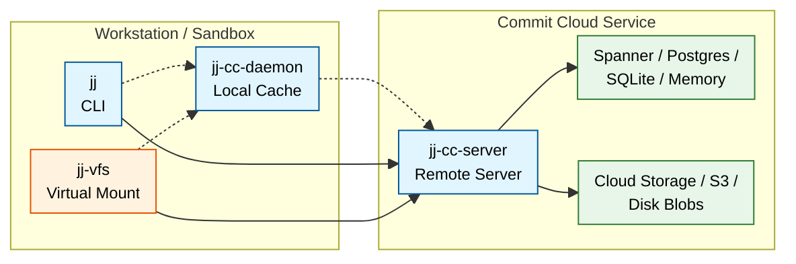

# jj-commit-cloud

jj-commit-cloud is a cloud-backed repository storage system for [jj](https://github.com/jj-vcs/jj) (Jujutsu). Standard jj stores commits, directory trees, file contents, and the operation log on one machine inside `.git/` and `.jj/`. jj-commit-cloud moves that state into a [shared remote service](server/). Developers, cloud IDEs, and coding agents can open and modify repositories across workstations, VMs, and short-lived sandboxes without cloning packfiles onto every disk or contending on `.lock` files.

Because upstream jj separates its version control library (`jj_lib`) from physical storage traits, the [Commit Cloud CLI](cli/) embeds upstream jj's command runner alongside [remote storage backends](lib/). Everyday commands (`jj status`, `jj diff`, `jj new`, `jj describe`, `jj rebase`, `jj squash`, `jj op log`, `jj undo`) work the same way in a cloud-backed workspace as in a local checkout. For on-demand virtual checkouts, workspaces pair with [jj-vfs](https://github.com/jj-vcs/jj-vfs). An optional per-user [local caching daemon](daemon/) keeps warm commit, tree, and file reads local, and existing Git repositories import and export without changing commit hashes.

## Why Commit Cloud

Local version control stores an entire repository inside a `.git/` directory on one disk. That model works well for a single checkout on one laptop, yet runs into three bottlenecks as repositories grow and as developers, cloud IDEs, and coding agents work in parallel:

* **Repeated Clones Across Machines and Sandboxes:** Every new workstation, CI job, or short-lived agent sandbox must download gigabytes of packfiles onto local disk before reading a single file or authoring a commit.
* **Lock Contention and Blocking Conflicts:** Concurrent processes sharing a checkout contend on `.git/index.lock` and reference locks, while merge conflicts write conflict markers onto disk and halt rebases mid-stack until resolved by hand.
* **Machine-Bound Work in Progress:** Unpushed commits, working-copy edits, and undo history exist only on the machine where they were created, forcing users and agents to push temporary branches just to inspect or resume an active stack elsewhere.

<!--
Diagram styling and update instructions:
- Uses compact Mermaid flowchart LR (12px font, tight spacing) showing runtime processes (#e1f5fe / #01579b for Commit Cloud binaries, #fff3e0 / #e65100 for jj-vfs) and backing storage systems (#e8f5e9 / #2e7d32).
- To update: edit the node or edge declarations below and preview the rendered Mermaid block in Markdown.
-->


## How Commit Cloud Works

### Projects, Repositories, and Workspaces

One Commit Cloud deployment serves an entire team or organization, separating shared codebase history from each person's or agent's active state:

* **Projects** own an isolated pool of immutable commits, directory trees, symlinks, and file-ownership records. Unrelated codebases, such as an operating-system kernel and a web service, live in separate projects on the same server with disjoint commit histories.
* **Repositories** belong to a project and own an independent operation log, active operation heads, bookmarks, and working-copy commit pointers (`@`). Dozens of developers and coding agents working on the same codebase share the project's deduplicated commits and files without interfering with one another's bookmarks or `jj undo` history. Standalone repositories created without `--project-id` receive a private project by default. Large fleets sharing one project can opt out of shared-project commit sync with `commit-cloud.sync-project-commits = false` and index specific commits on demand via `jj cc init --index-commit <commit-id>`.
* **Workspaces** represent individual local or virtual checkouts attached to a repository (`jj cc workspace`), syncing their checked-out commit, trees, and sparse patterns to the server so tools and orchestrators can inspect active sandboxes across hosts.

### Lock-Free Concurrency and Stored Conflicts

Writers never acquire repository locks. Parallel edits from multiple terminals or coding agents append concurrent entries to the repository's operation log, and jj-cc-server merges divergent operation heads on the server using jj's 3-way view merge and algebraic tree conflict representation (`Merge<TreeId>`).

### Git Compatibility and Migration

Commits, directory trees, symlinks, submodules, and files use Git-compatible content-addressed object hashes. Existing Git repositories import into Commit Cloud (`jj cc import-git`) and export back to Git (`jj cc export-git`) with identical commit hashes, allowing teams to adopt Commit Cloud alongside existing Git hosts and CI pipelines.

### Storage, Local Caching, and Virtual Workspaces

Enabling the per-user [local caching daemon](daemon/) routes workspace traffic over a local socket and serves warm commit, tree, symlink, file, view, and operation reads from memory and local disk. Pairing with [jj-vfs](https://github.com/jj-vcs/jj-vfs) mounts trees on demand without downloading untouched files.

On the server, Commit Cloud supports in-memory maps or embedded [SQLite](https://www.sqlite.org/) with local disk for single-node setups, self-hosted [PostgreSQL](https://www.postgresql.org/) with S3-compatible object storage (such as MinIO or Amazon S3), and multi-region [Cloud Spanner](https://cloud.google.com/spanner) or containerized [Spanner Omni](https://cloud.google.com/products/spanner/omni) with [Cloud Storage](https://cloud.google.com/storage). When cross-region Cloud Storage replication lags, regional servers fall back to the origin bucket. All storage backends compile into the same jj-cc-server binary. The server supports Bearer, OIDC JWT, and Kubernetes `TokenReview` authentication, along with optional `/healthz`, `/statz`, and Prometheus `/metrics` endpoints.

## Getting Started

### Starting a Local Server

With a [Rust toolchain](rust-toolchain.toml) installed, launch a local SQLite + local-disk server, run end-to-end verification, and build the jj CLI and jj-cc-daemon with `cargo xtask` or `cargo` across Linux, macOS, and Windows:

```bash
# Start a local SQLite + disk (or PostgreSQL + MinIO S3) server, smoke-test, and benchmark:
cargo xtask up sqlite
# Or: cargo xtask up postgres
cargo xtask smoke
cargo xtask bench --agents 12 --commits-per-agent 3 --daemon
cargo xtask down

# Build ./target/release/jj and ./target/release/jj-cc-daemon (or run a standalone server):
cargo build --release -p cli -p jj-commit-cloud-daemon
cargo run --release -p jj-commit-cloud-server -- --store-type sqlite --blob-store local
```

### Working in a Cloud Repository

Once a Commit Cloud server is reachable and the custom jj binary is on your `PATH`, cloud workspaces use `jj cc` for setup and standard jj commands for daily work:

```bash
# Initialize a cloud-backed workspace and author changes with standard jj commands:
mkdir -p ~/work/ws1
jj cc init --server http://127.0.0.1:8080 --create ~/work/ws1
cd ~/work/ws1
printf 'hello commit cloud\n' > README.txt
jj describe -m "add greeting"
jj new -m "next change"
jj log

# Clone that cloud repository into another workspace (or pass -r <rev> for an earlier commit):
REPO_ID=$(sed -n 's/^repo_id = "\(.*\)"/\1/p' .jj/repo/store/config.toml)
jj cc clone --server http://127.0.0.1:8080 "$REPO_ID" ~/work/ws2
jj cc workspace list
jj cc daemon enable

# Export Commit Cloud history to a standard Git repo or import an existing Git repo:
jj bookmark set main -r @-
jj cc export-git --bare --git-dir /tmp/exported.git
jj cc import-git --server http://127.0.0.1:8080 --create --git-dir /tmp/exported.git
```

## Documentation

* **[System Design](docs/design.md):** End-to-end architecture, how independent projects and shared repository pools work, pluggable `jj_lib` storage backends, life of a command, client workflows, and future directions.
* **[Data Model and Storage Layout](docs/data-model.md):** Domain entities (projects, repositories, operations, views, workspaces, commits, trees, and blobs), canonical hashing, comparison with local Git storage, and database schemas.
* **[Cloud Spanner and Cloud Storage Architecture](docs/spanner-and-gcs-design.md):** Separating graph metadata from file byte streams, Spanner table layout, lock-free operation-head concurrency, and cross-region replication-lag recovery.
* **[Running the Server on Cloud Spanner](docs/spanner.md):** Step-by-step guide to build jj-cc-server and the jj CLI, create a Cloud Spanner or emulator database, connect two workspaces, and verify concurrent-writer reconciliation with expected output for each step.
* **[Developer and Deployment Guide](docs/development-and-deployment.md):** Workspace crate layout, building and running tests, local Docker/Podman and Kubernetes topologies, and cloud deployment workflows.
* **[Contributing](docs/contributing.md):** Contribution workflow and Contributor License Agreement (CLA) details.

## License

Licensed under the [Apache License, Version 2.0](LICENSE); see [Contributing](docs/contributing.md#source-code-headers) for the required source-file copyright header.
