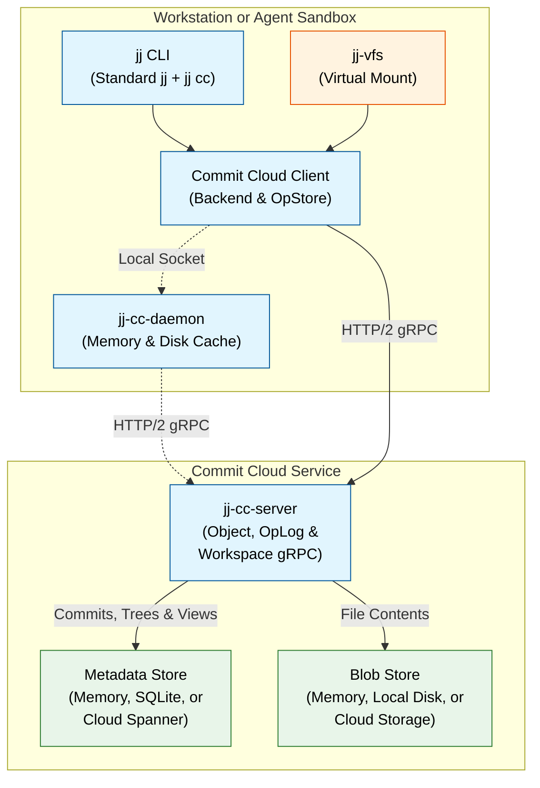

# jj-commit-cloud

jj-commit-cloud is a cloud-backed repository storage system for [jj](https://github.com/jj-vcs/jj) (Jujutsu). Standard jj stores a repository's commits, directory trees, file contents, and operation log on one machine inside `.git/` and `.jj/`. jj-commit-cloud moves that repository state into a [shared remote service](server/), letting developers, cloud IDEs, and parallel coding agents open, inspect, and evolve repositories across workstations, cloud VMs, and ephemeral sandboxes without cloning packfiles onto every disk or contending on local `.lock` files.

Because upstream jj separates its version control library (`jj_lib`) from physical storage traits, the [Commit Cloud CLI](cli/) embeds upstream jj's command runner alongside [remote storage backends](lib/). Everyday commands (`jj status`, `jj diff`, `jj new`, `jj describe`, `jj rebase`, `jj squash`, `jj op log`, `jj undo`) work the same way in a cloud-backed workspace as in a local checkout, while pairing with [jj-vfs](https://github.com/jj-vcs/jj-vfs) for on-demand virtual checkouts, and an optional per-user [local caching daemon](daemon/) keeps warm commit, tree, and file reads local. Existing Git repositories import and export without changing commit hashes.

## Why Commit Cloud

Local version control stores an entire repository inside a `.git/` directory on one disk. That model works well for a single checkout on one laptop, yet runs into three bottlenecks as repositories grow and as developers, cloud IDEs, and coding agents work in parallel:

* **Repeated Clones Across Machines and Sandboxes:** Every new workstation, CI job, or short-lived agent sandbox must download gigabytes of packfiles onto local disk before reading a single file or authoring a commit.
* **Lock Contention and Blocking Conflicts:** Concurrent processes sharing a checkout contend on `.git/index.lock` and reference locks, while merge conflicts write conflict markers onto disk and halt rebases mid-stack until resolved interactively.
* **Machine-Bound Work in Progress:** Unpushed commits, working-copy edits, and undo history exist only on the machine where they were created, forcing users and agents to push temporary branches just to inspect or resume an active stack elsewhere.

<!--
Diagram styling and update instructions:
- Uses Mermaid flowchart TD with quoted node labels, <br/> line breaks that keep the diagram within the page width, and standard palette classes (#e1f5fe fill, #01579b border for active components; #fff3e0 fill, #e65100 border for workspace surfaces; #e8f5e9 fill, #2e7d32 border for storage backends).
- To update: edit the node or edge declarations below and run `jj fix -s @`.
-->


## How Commit Cloud Works

### Projects, Repositories, and Workspaces

One Commit Cloud deployment serves an entire team or organization, separating shared codebase history from each person's or agent's active state:

* **Projects** own an isolated pool of immutable commits, directory trees, symlinks, and file-ownership records. Unrelated codebases - such as an operating-system kernel and a web service - live in separate projects on the same server with disjoint commit histories.
* **Repositories** belong to a project and own an independent operation log, active operation heads, bookmarks, and working-copy commit pointers (`@`). Dozens of developers and coding agents working on the same codebase share the project's deduplicated commits and files without interfering with one another's bookmarks or `jj undo` history. Standalone repositories created without `--project-id` receive a private project automatically.
* **Workspaces** represent individual local or virtual checkouts attached to a repository (`jj cc workspace`), syncing their checked-out commit, trees, and sparse patterns to the server so tools and orchestrators can inspect active sandboxes across hosts.

### Lock-Free Concurrency and First-Class Conflicts

Writers never acquire repository locks. Parallel edits from multiple terminals or coding agents append concurrent entries to the repository's operation log, and jj-cc-server merges divergent operation heads on the server using jj's 3-way view merge and algebraic tree conflict representation (`Merge<TreeId>`).

### Git Compatibility and Migration

Commits, directory trees, symlinks, submodules, and files use Git's 20-byte SHA-1 object hashes via [gitoxide](https://github.com/GitoxideLabs/gitoxide). Existing Git repositories import into Commit Cloud (`jj cc import-git`) and export back to Git (`jj cc export-git`) with identical commit hashes, allowing teams to adopt Commit Cloud alongside existing Git hosts and CI pipelines.

### Storage, Local Caching, and Virtual Workspaces

Enabling the per-user [local caching daemon](daemon/) routes workspace traffic over a local socket and serves warm commit, tree, symlink, file, view, and operation reads from memory and local disk, while [jj-vfs](https://github.com/jj-vcs/jj-vfs) mounts trees on demand without downloading untouched files. On the backend, Commit Cloud runs against in-memory maps or embedded [SQLite](https://www.sqlite.org/) and local disk for single-node setups, and scales across regions on [Cloud Spanner](https://cloud.google.com/spanner), containerized [Spanner Omni](https://cloud.google.com/products/spanner/omni), and [Cloud Storage](https://cloud.google.com/storage) with automatic origin fallback when cross-region object replication lags.

## Getting Started

### Starting a Local Server

With a [Rust toolchain](rust-toolchain.toml) installed, launch a local server, run end-to-end verification, and build the `jj` CLI with `cargo xtask` across Linux, macOS, and Windows:

```bash
cargo xtask up sqlite
cargo xtask smoke
cargo xtask bench --agents 12 --commits-per-agent 3 --daemon
cargo build --release -p cli    # builds ./target/release/jj
cargo xtask down
```

For Docker and Podman Compose profiles ([compose.yaml](compose.yaml)), local Kubernetes ([deploy/k8s/](deploy/k8s/)), Cloud Spanner and Cloud Storage emulators, and deployments to Cloud Run, Compute Engine, and GKE, see the [Developer and Deployment Guide](docs/development-and-deployment.md).

### Working in a Cloud Repository

Once a Commit Cloud server is reachable and the custom `jj` binary is on your `PATH`, cloud workspaces use `jj cc` for setup and standard `jj` commands for daily work:

```bash
# Initialize a cloud-backed workspace and author changes with standard jj commands:
jj cc init --server http://127.0.0.1:8080 --create ~/work/ws1
cd ~/work/ws1
printf 'hello commit cloud\n' > README.txt
jj describe -m "add greeting"
jj new -m "next change"
jj log

# Clone that cloud repository into another workspace (or pass -r <rev> for an earlier commit):
REPO_ID=$(sed -n 's/^repo_id = "\(.*\)"/\1/p' .jj/repo/store/config.toml)
jj cc clone --server http://127.0.0.1:8080 "$REPO_ID" ~/work/ws2
jj cc workspace list
jj cc daemon enable

# Export Commit Cloud history to a standard Git repo or import an existing Git repo:
jj bookmark set main -r @-
jj cc export-git --bare --git-dir /tmp/exported.git
jj cc import-git --server http://127.0.0.1:8080 --create --git-dir /tmp/exported.git
```

## Documentation

* **[System Design](docs/design.md):** End-to-end architecture, how independent projects and shared repository pools work, pluggable `jj_lib` storage backends, life of a command, client workflows, and future directions.
* **[Data Model and Storage Layout](docs/data-model.md):** Domain entities (projects, repositories, operations, views, workspaces, commits, trees, and blobs), canonical hashing, comparison with local Git storage, and database schemas.
* **[Cloud Spanner and Cloud Storage Architecture](docs/spanner-and-gcs-design.md):** Separating graph metadata from file byte streams, interleaved Spanner schema design, lock-free operation-head concurrency, and cross-region replication-lag recovery.
* **[Developer and Deployment Guide](docs/development-and-deployment.md):** Workspace crate layout, building and running tests, local Docker/Podman and Kubernetes topologies, and cloud deployment workflows.
* **[Contributing](docs/contributing.md):** Contribution workflow and Contributor License Agreement (CLA) details.

## License

Licensed under the [Apache License, Version 2.0](LICENSE). Every source file must retain the standard Apache 2.0 copyright header:

    Copyright 2026 Google LLC

    Licensed under the Apache License, Version 2.0 (the "License");
    you may not use this file except in compliance with the License.
    You may obtain a copy of the License at

        https://www.apache.org/licenses/LICENSE-2.0

    Unless required by applicable law or agreed to in writing, software
    distributed under the License is distributed on an "AS IS" BASIS,
    WITHOUT WARRANTIES OR CONDITIONS OF ANY KIND, either express or implied.
    See the License for the specific language governing permissions and
    limitations under the License.
