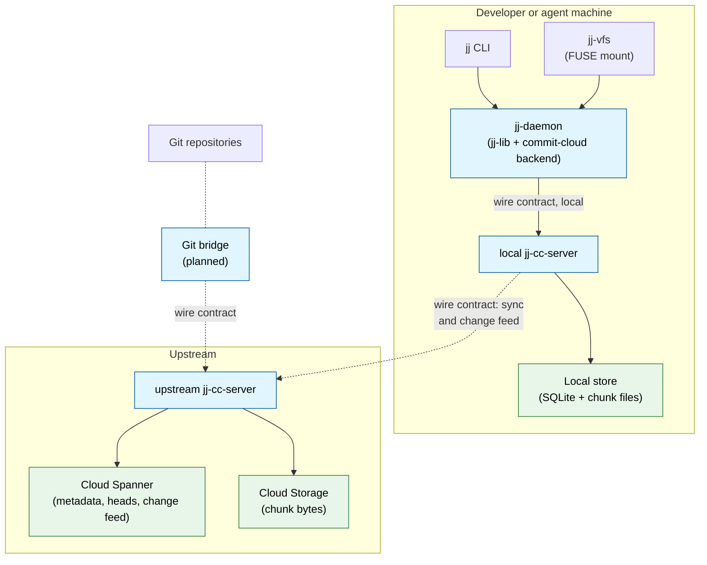
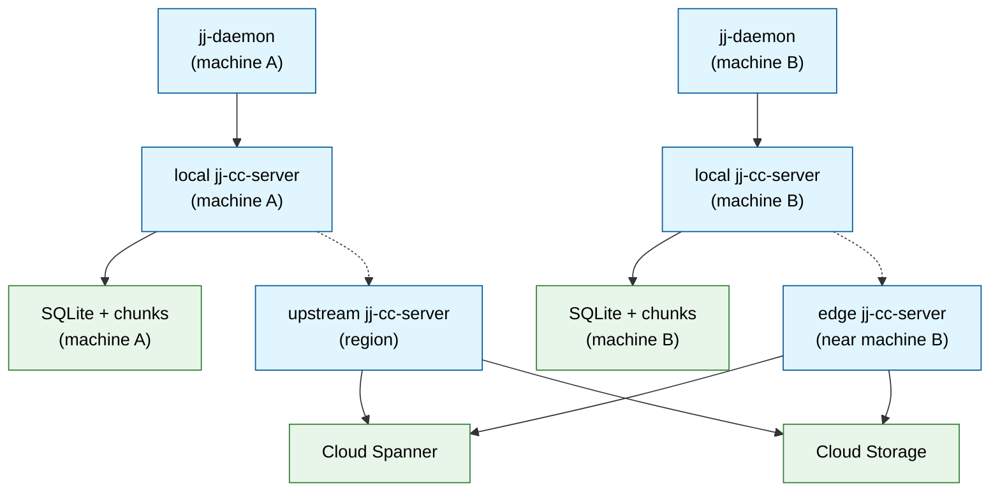
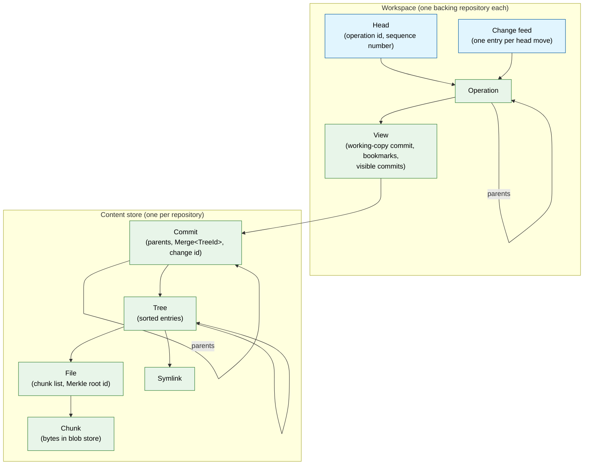
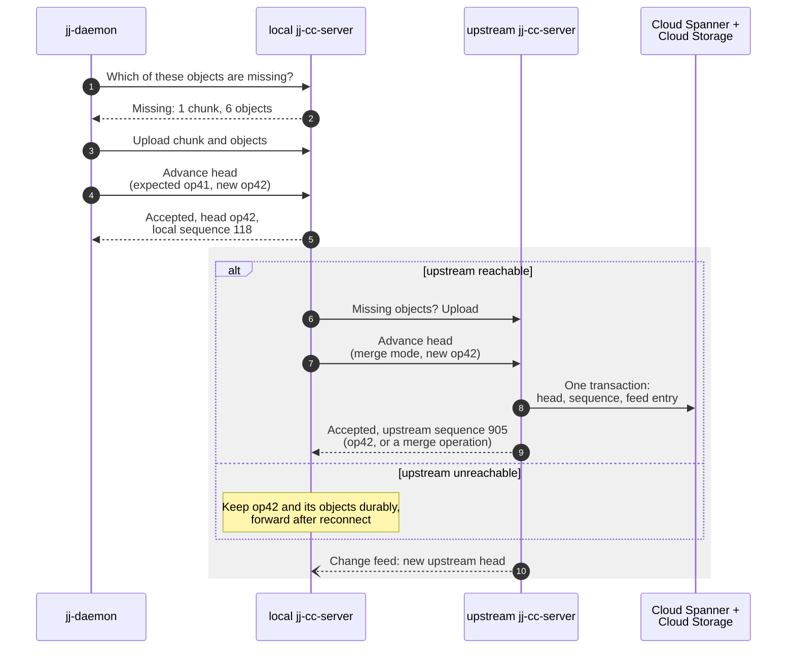
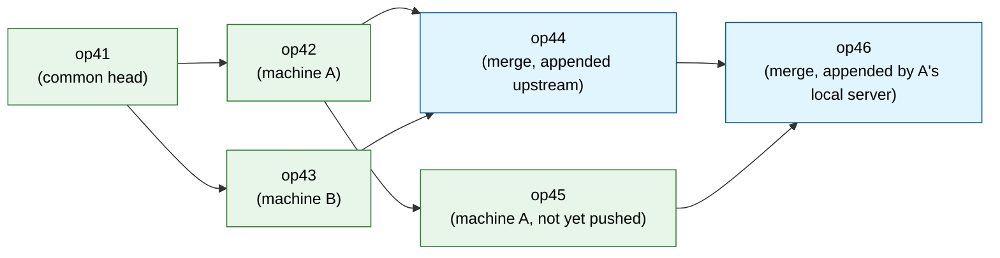
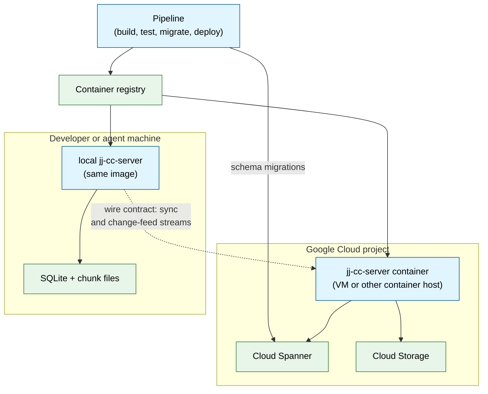

# jj-commit-cloud architecture

## Summary

Many people and coding agents work on one large [jj](https://github.com/jj-vcs/jj) repository at once, each in their own workspace, and every snapshot should reach other machines without an explicit push. jj-commit-cloud stores the objects and operation logs of such repositories and moves them between machines.

One server binary, jj-cc-server, runs in two places: on each developer or agent machine as a local server, and in the cloud as an upstream server. The local server answers jj-daemon, the version-control process of [jj-vfs](https://github.com/jj-vcs/jj-vfs), from local state. It fetches content it does not hold from the upstream and syncs what it accepts to the upstream in the background.

## Key choices

* **Immutable objects, one mutable head:** objects are content-addressed and never change; each workspace has one head, moved by compare-and-swap.
* **Append-only servers:** a server never rewrites an operation it has accepted.
* **Asynchronous across the network:** publishing completes against the local server.
* **Chunked files:** a file id is the root of a Merkle tree over chunk hashes.
* **SHA-256 identity:** every digest names its algorithm.
* **Storage behind traits:** [Cloud Spanner](https://cloud.google.com/spanner) and [Cloud Storage](https://cloud.google.com/storage) upstream, [SQLite](https://sqlite.org) and local files on a machine, memory in tests.

The code in this repository is an earlier proof of concept; [What works now](#what-works-now) lists what it does and where it differs from this design.

## Goals and constraints

* **Concurrent writers:** many people and agents work on one repository at once, each in their own workspace. One person or agent writes a workspace in the common case; several writers are allowed, for example a person and an agent in the same workspace, or one workspace on two machines.
* **Local-first writes:** a snapshot completes against the local server. Upload, upstream ordering and notification happen later.
* **Remote visibility:** a change published on one machine reaches other machines through the change feed, without a command.
* **No waiting between writers:** no write waits on another writer. The only ordering point is the compare-and-swap on a workspace head. Short in-memory locks that protect local state are allowed.
* **jj model:** objects follow jj's model (`Commit`, `Merge<TreeId>`, `Operation`, `View`), clients use [jj-lib](https://docs.rs/jj-lib)'s `Backend`, `OpStore` and `OpHeadsStore` traits, and server-side merges use jj-lib.
* **Network:** nothing that crosses a network is expected to be in sync. Long-running local processes that talk over Unix sockets, such as jj-daemon and the local server, may rely on each other's answers being current.
* **Portability:** Rust, gRPC and Linux containers. Cloud Spanner is the reference metadata store. A replacement must offer one serializable transaction that writes a workspace head, its sequence number and its change-feed entry together (see Head transaction below). Other blob stores can replace Cloud Storage.

## System context

<!--
Diagram styling and update instructions:
- Mermaid flowchart TD with quoted node labels and <br/> line breaks.
- Palette: #e1f5fe fill, #01579b border for components of this design; #e8f5e9 fill, #2e7d32 border for storage. Unstyled nodes are outside this design.
- Solid edges are local calls and streams; dotted edges cross the network asynchronously or lead outside this design. The same meaning holds in every diagram of this document.
- To update: edit the node or edge declarations below and preview the rendered Mermaid block in Markdown.
-->


On a developer machine, jj-daemon is the only client of a jj-cc-server. It links jj-lib with a commit-cloud backend: implementations of jj's `Backend`, `OpStore` and `OpHeadsStore` traits that call the local server. jj-vfs and the jj CLI never talk to a server; their interfaces are described in the [jj-vfs architecture document](https://github.com/jj-vcs/jj-vfs/blob/main/docs/architecture.md).

## Server topology

Every jj-cc-server is the same program. Its configuration decides its role:

* **Local server:** runs on the machine next to jj-daemon. It checks requests, holds the objects the machine has used, orders the head moves it accepts, and syncs with one upstream. Publishing, and reads of content the machine already holds, keep working when the upstream is unreachable.
* **Upstream:** a group of upstream server instances in the cloud that share one Cloud Spanner database and one Cloud Storage bucket. The shared database orders every workspace head, so the group acts as one authority.
* **Edge server:** an upstream instance deployed close to a group of clients and sharing the same storage. It serves immutable objects from nearby; head moves still commit in the shared database.

Each local server numbers the head moves of each workspace itself, and the upstream numbers them in its shared database, so local and upstream sequence numbers differ.

<!--
Diagram styling and update instructions:
- Mermaid flowchart TD with quoted node labels and <br/> line breaks.
- Palette: #e1f5fe fill, #01579b border for components; #e8f5e9 fill, #2e7d32 border for storage.
- Solid edges are local calls; dotted edges cross the network asynchronously.
- To update: edit the node or edge declarations below and preview the rendered Mermaid block in Markdown.
-->


## Components

| Component | Responsibility |
|---|---|
| jj-cc-server | Serves content, workspace heads and the change feed over gRPC; appends merge operations in merge mode; syncs with an upstream when configured with one. |
| Wire contract | Defines the protobuf messages shared by jj-cc-server, jj-daemon and the Git bridge. The jj-vfs repository pins a revision of it for jj-daemon. |
| Client library | Implements the wire contract for clients: the commit-cloud backend that jj-daemon links, and the client side of a local server's sync with its upstream. |
| Metadata store trait | Stores repositories, workspaces, heads, sequence numbers, the change feed, and the canonical bytes of objects. Implementations: Cloud Spanner, SQLite, memory. |
| Blob store trait | Stores chunk bytes, written before any metadata refers to them. Implementations: Cloud Storage, local files, memory. |
| Chunk crate | Splits files into chunks and computes file ids. Shared with jj-daemon, so both sides compute the same ids. |
| Git bridge | Planned: imports from and exports to Git repositories as a client of the wire contract. [Copybara](https://github.com/google/copybara) is one candidate for continuous import and export; a native importer built on jj-lib can cover the first full import of a repository's history. |
| Schema migrations | Versioned schema files that the deployment pipeline applies before a server starts. |
| Test utilities | Start servers for integration tests. |

## Data model

Users see a repository with several workspaces. A user creates each workspace, and its name starts with that user's name, for example `alice/feature`. Each workspace has its own operation log and its own head - the newest operation in that log - and the head's `View` records the working-copy commit. In jj today, all workspaces of a repository share one operation log.

Inside the server, one content store per repository holds the objects that all its workspaces share. Each workspace is a separate backing repository with its own operation log, operations and views. The backing repository is an implementation detail and may change. A planned channel inside the server lets one workspace's operation log refer to commits that another workspace published; it is not designed yet.

<!--
Diagram styling and update instructions:
- Mermaid flowchart TD used as a schema diagram, quoted labels with <br/> line breaks.
- Palette: #e1f5fe fill, #01579b border for mutable per-workspace state; #e8f5e9 fill, #2e7d32 border for immutable objects. Operations and views are immutable; the subgraph shows only that they belong to one workspace.
- Arrows point from an object to the objects it references.
- To update: edit the node or edge declarations below and preview the rendered Mermaid block in Markdown.
-->


* **Objects:** trees, files, symlinks, commits, operations and views. Each has canonical bytes and an id derived from them; the server verifies every digest on upload and returns the stored bytes unchanged, so any server or cache can keep an object forever. Chunks are stored apart, in the blob store.
* **Files and chunks:** a file is an ordered list of chunks with their lengths. The file id is the root of a Merkle tree over the chunk hashes, so a reader can check any chunk without fetching the whole file.
* **Heads and the change feed:** each server keeps one head per workspace and a sequence number with no gaps. Every head move appends one entry, with that server's next number, to the workspace's change feed: the ordered stream of head moves that clients follow.
* **History:** servers only append to an operation log. A workspace's operation log lives as long as the workspace. When a workspace's work lands in a shared trunk - a workspace that receives finished work - the operation log does not travel with it: the landing is one operation in the trunk. Landing depends on the cross-workspace channel.

## Wire API

The wire contract is still being defined. Its responsibilities:

* **Server information:** protocol version, supported hash algorithms, message and batch limits, and the server build.
* **Content:** find which objects the server lacks, upload chunks and objects, and read trees, file metadata, chunks and objects. Large listings are paged.
* **Workspaces:** create a workspace from a commit or from another workspace, read its head, and advance its head. An advance names the head it expects. By default the server rejects it when the head has moved. In merge mode the server instead appends a merge operation whose parents are the current head and the new operation, so nothing is rejected and nothing is rewritten.
* **Change feed:** stream head moves for the workspaces a client follows, starting after a given sequence number of that server, with heartbeats so a client can detect a dead stream.

Rules for every call:

* **Digests:** every digest names its algorithm, and a repository declares one format per object kind.
* **Closure before head:** a server accepts a new head only when every object that head reaches is stored, or, on a local server, known upstream. Known upstream means received from the upstream or acknowledged by it, together with everything those objects reach. Because objects are immutable, a local server can fetch such objects later and cache them forever. The publisher uploads the objects its new head introduces.
* **Checks on publish:** the expected head is current (default mode only), and the client's protocol version is supported.
* **Typed retries:** errors say whether to retry after a backoff, after uploading missing objects, or after re-applying onto a newer head.
* **Additive evolution:** clients ignore fields and events they do not know. A breaking change becomes a new protocol version served alongside the old one.

## Key flows

### Publish a snapshot

jj-daemon snapshots a workspace after files change and publishes the result to the local server. The local server makes the new head durable and answers; it forwards to its upstream later, in merge mode, because its own clients may already build on what it accepted.

<!--
Diagram styling and update instructions:
- Mermaid sequenceDiagram with <br/> line breaks in participant labels and messages to keep the width compact.
- The shaded rect marks the part that runs after jj-daemon already has its answer. Sequence numbers are per server: local 118, upstream 905.
- To update: edit the sequence steps below and preview the rendered Mermaid block in Markdown.
-->


The order of writes is described in [Consistency and crash safety](#consistency-and-crash-safety). The local server answers "accepted" only after the head, its objects and its chunks are durable on local disk. The upstream's change feed echoes the new head back to the local server, which learns the upstream sequence number and any merge operation from it. After an outage the local server forwards what it accepted in the same way.

### Follow a workspace

A client subscribes to the workspaces it shows. Each event carries the workspace, the new head and the sequence number of the server that sent it. After a gap or a reconnect, a client reads the head and resumes from its last sequence number; if the server no longer has that part of the feed, it tells the client to resync from the current head. The server keeps per-client state only while a stream is open.

The local server follows its upstream the same way, and jj-daemon follows the local server; each resumes against the numbers of the server it follows. When a new head arrives, jj-daemon fetches the new operation, `View` and changed trees, and tells jj-vfs which paths to invalidate. Writes on the machine that jj-daemon has not snapshotted yet are covered in the jj-vfs document.

### Two writers race

In the examples, opN is an operation, tree is the tree of the working-copy commit in that operation's `View`, and seq is the server's sequence number. Two clients publish to workspace `alice/feature` on the same server from the same head:

```text
head = op41, seq 117, tree {A, B, C}
client 1: advance(expected op41, new op42)  op42 edits A  -> accepted, seq 118
client 2: advance(expected op41, new op43)  op43 adds D   -> rejected, head is op42
client 2: fetch op42, re-apply op43         -> op44 (A edited, D added)
client 2: advance(expected op42, new op44)                -> accepted, seq 119
followers: feed entries 118 (op42) and 119 (op44)
```

Re-applying replays a client's own operation, which no server has accepted, onto the new head: the snapshot's file changes are merged three ways into the new working-copy commit, and conflicts stay as jj conflicts. Only clients re-apply, and only when the case allows it, for example when the new head still has the working-copy change the snapshot modified. Otherwise the client publishes in merge mode and the change diverges.

Across machines, two local servers can each accept a different successor of the same head before either reaches the upstream:

```text
upstream head = op41
local server A accepted op42 (parent op41); local server B accepted op43 (parent op41)
A -> upstream: advance(merge mode, new op42)  -> head was op41, so op42 becomes the head
B -> upstream: advance(merge mode, new op43)  -> upstream appends op44 = merge of op42 and op43
upstream feed: op42, op44
```

The merge operation has both racing operations as parents, as jj does for concurrent operations. If both operations rewrote the same change, the change becomes divergent and the user resolves it with jj. Several writers in one workspace on two machines rewrite the same working-copy change, so their races always diverge. For now this is accepted: the merged `View` keeps one machine's working-copy commit, and the other machine's saves stay reachable as the other side of the divergent change until the user resolves it with jj. A planned improvement may converge divergent versions where the edits combine, for example edits to different files. It would produce one new version of the change that keeps both predecessors for `jj evolog`.

A local server can also fall behind: its own head moved on while a newer upstream head was on its way.

```text
local head = op45 (parent op42), not yet pushed; upstream head = op44 (merge of op42 and op43)
local server: receives op44 from the feed, appends op46 = merge of op45 and op44
local server -> upstream: advance(expected op44, new op46)  -> fast-forward, accepted
```

The operation graph of both examples, with each operation pointing to the operations built on it:

<!--
Diagram styling and update instructions:
- Mermaid flowchart LR, quoted labels with <br/> line breaks; arrows go from parent to child operation.
- Palette: #e8f5e9 fill, #2e7d32 border for operations, which are immutable; #e1f5fe fill, #01579b border for the merge operations servers append.
- To update: edit the node or edge declarations below and preview the rendered Mermaid block in Markdown.
-->


The merge descends from the upstream head, so the push is a fast-forward. The upstream merges only races that are still in flight, and no pair of operations is merged twice.

## Consistency and crash safety

* **Write order:** chunk bytes, then objects, then the head. Each step is idempotent, and a crash between steps leaves only unreferenced data, never a dangling reference.
* **Head transaction:** upstream, the head, its sequence number and its change-feed entry are written in one Cloud Spanner read-write transaction, so two writers never both succeed against the same expected head.
* **Ordering points:** each local server orders the head moves it accepts; upstream, the shared database orders them. A local head may lead or lag the upstream head.
* **No gaps:** sequence numbers per workspace and per ordering point have no gaps, so a follower detects every missed event.
* **At-least-once delivery:** feed events arrive at least once while a stream is open, and a client catches up by sequence number afterwards.

## Security

Planned interim step: each client authenticates with a Google Cloud access token obtained through [gcloud](https://cloud.google.com/sdk/gcloud). This is not the final design, and nothing is implemented yet.

Later stages add TLS on every connection between machines, authentication separate from authorization, checks of the original user's rights on requests that a local server forwards upstream, and local sockets that accept connections only from the owning operating-system user.

## Deployment

<!--
Diagram styling and update instructions:
- Mermaid flowchart TD with quoted node labels and <br/> line breaks.
- Palette: #e1f5fe fill, #01579b border for components; #e8f5e9 fill, #2e7d32 border for storage.
- Solid edges are local calls or deployment steps; dotted edges cross the network asynchronously.
- To update: edit the node or edge declarations below and preview the rendered Mermaid block in Markdown.
-->


* **Docker hosts:** the server's [Docker](https://www.docker.com) image takes its store type and connection settings from flags and environment variables. A machine with SQLite and a local blob directory runs the same image as a cloud deployment.
* **Google Cloud target:** containers on [Compute Engine](https://cloud.google.com/compute) VMs with Cloud Spanner and Cloud Storage, and no public IP on the hosts.
* **Long-lived streams:** change-feed streams stay open for hours. A host and its ingress must allow long-lived HTTP/2 streams; a platform with a request time cap forces clients to reconnect and resume by sequence number.
* **Migrations:** the pipeline applies schema changes before deploying a server. The server never changes its own schema.

## Key decisions

| Decision | Why | Cost | Main alternative |
|---|---|---|---|
| One server binary, local and upstream | One protocol and code path; publishing and repeated reads without the network | A store, a set of sequence numbers and merge code on every machine | jj-daemon talks to the upstream server directly |
| Servers only append to operation logs | Clients can build on anything a server accepted | Races leave merge operations and, at times, divergent changes | Servers re-apply operations onto newer heads |
| One head per workspace, compare-and-swap | Writers on one server are ordered without locks; followers read one head | Losing clients re-apply; forwarded operations need merge mode | A set of heads merged on every read |
| Each workspace is a backing repository | Works with current jj-lib, which has no per-workspace operation heads | A cross-workspace channel to design | Wait for independent workspaces in jj-lib |
| Asynchronous network sync | Local writes never wait on the network | Accepted locally is not yet shared | Synchronous publish to the upstream |
| Chunked files, Merkle-root ids | Large files, partial reads, per-chunk verification | A chunk index per file | Whole-file blobs |
| SHA-256 digests that name their algorithm | One hash for new repositories, room for SHA-1 | Git SHA-1 ids need a mapping | Git SHA-1 ids |
| Cloud Spanner for metadata, Cloud Storage for bytes | Transactional heads across instances; bulk bytes outside the database | Two services to run and pay for | One database for both |
| Storage behind traits | Runs on SQLite on a machine and in memory in tests | Every backend must pass the same tests | One fixed backend |
| gRPC | Streaming, typed contracts, Rust support | Needs HTTP/2 end to end | REST |

## Open questions

* **Local server contents:** what a local server keeps and evicts, how it reports to jj-daemon whether a change has reached the upstream, and whether one local server serves a machine or each operating-system user.
* **Merges on a local server:** a merge reads `View`s and commits, which a lazily filled local server may lack while offline.
* **Wire contract:** the calls, messages and error codes.
* **Cross-workspace channel:** how one workspace's backing repository refers to commits from another.
* **Workspace names:** whether pipelines such as CI are exempt from the user-name prefix.
* **Object encoding and hashes:** the exact encoding and hash of objects.
* **Chunking and SHA-1:** chunking method and parameters, the manifest layout for large files, and how imported Git ids are kept next to SHA-256 ids.
* **Convergence:** when a server may converge divergent versions of a change into one, and the exact rules.
* **Server-created operations:** which author and host identity merge operations carry, and whether a merge runs inside or outside the head transaction.
* **Feed fan-out:** how upstream instances and edges with open streams learn of a head move that another instance committed.
* **Subscriptions and feed retention:** stream-only, or stored subscriptions with leases; how long feed entries are kept.
* **Bookmarks:** per workspace in each `View`, or one shared pointer, which would be a second mutable pointer.
* **Authentication and authorization:** the final design, including identity on forwarded requests.
* **Ingress:** how clients reach upstream servers in Google Cloud, and what stream duration the ingress allows.
* **Deleted workspaces:** how their operations and objects are collected, without removing objects that an unsynced local head may still reference.
* **Git bridge:** its design and whether Copybara is used.

## Risks

* **Backing repositories:** the cross-workspace channel is not designed; landing work in a trunk and building on another workspace's commits depend on it. The model may need a migration once jj-lib gains independent workspaces.
* **jj-lib coupling:** server-side merges tie the server to jj-lib releases, so every jj-lib upgrade touches the server.
* **Merge cost and hot heads:** upstream merges run jj-lib work that reads `View`s and objects, which lengthens transactions or adds retry loops, and a shared trunk concentrates every landing on one head row.

## Non-goals

* Direct Git protocol access.
* Git submodules.
* Automated operation-log compaction.
* Encryption at rest and purging secrets from history.
* Per-workspace permissions.

## What works now

This repository holds a proof of concept (PoC) that predates the design above. Its terms differ from the target:

| PoC term | Meaning | Closest target term |
|---|---|---|
| Project | Shared objects of several PoC repositories | Content store |
| Repository | One jj repository with one operation log, which several jj workspaces share | Backing repository, when it holds one workspace |
| Workspace | Working-copy state of one jj workspace, keyed by repository, user and name and stored on the server | None |

Its crates:

* **[common/](../common/):** three gRPC services in [common/proto/](../common/proto/) - `BackendService`, `OpStoreService`, `WorkspaceService` - with 23 RPCs, plus conversions between jj-lib types and protobuf. The server also registers the standard gRPC health service.
* **[lib/](../lib/):** jj-lib `Backend`, `OpStore` and `OpHeadsStore` implementations over gRPC; `IndexStore` and `WorkingCopy` wrappers around jj's local implementations that fill the index from the server and report working-copy state to it; and a Git importer.
* **[cli/](../cli/):** a jj binary with `jj cc init`, `jj cc import-git` and `jj cc daemon`, which turns daemon mode on or off and shows its status.
* **[server/](../server/):** jj-cc-server with a `Store` trait in [server/src/store/mod.rs](../server/src/store/mod.rs) and memory, SQLite and Cloud Spanner backends.
* **[daemon/](../daemon/):** jj-cc-daemon, a pass-through proxy from a Unix socket to the server. Daemon mode is on by default: the client starts jj-cc-daemon when its socket does not answer, and uses direct gRPC only if starting it fails. jj-cc-daemon is unrelated to jj-daemon; the local jj-cc-server replaces it.
* **[testutils/](../testutils/):** builds and starts servers (memory and SQLite) and jj-cc-daemon for the CLI tests. One test mounts jj-vfs; it is ignored by default because it needs jjfsd and FUSE.

The CLI tests cover initializing a repository against a server, snapshots, `jj log` and `jj op log`; several repositories sharing one project's objects with isolated operation logs; workspace state on the server; stale-head rejection and server-side merging of concurrent operation heads; and the SQLite store, Git import and jj-cc-daemon. The [Dockerfile](../Dockerfile) was written for Cloud Run: it builds a server image with all three stores, and its default command selects Cloud Spanner through a `SPANNER_DATABASE` setting that must be filled in.

| Area | Proof of concept | Target |
|---|---|---|
| Ids | Git SHA-1 for commits, trees and files; truncated SHA-1 for operations and views | SHA-256, digests name their algorithm |
| Verification | Client-supplied commit ids are stored unchecked | Every digest verified on upload |
| Files | Whole file in one message in both directions; files over the gRPC message limit fail | Chunks with Merkle-root ids |
| Heads | Set of operation heads per repository; stale updates rejected; concurrent heads merged when a repository loads | One head per workspace, moved by compare-and-swap; servers only append to operation logs |
| Cloud Spanner head update | Read and write in separate transactions, not atomic | One read-write transaction with the feed entry |
| Change feed | None | Sequence numbers and streaming subscriptions |
| Schema | Server creates tables at startup, unversioned | Versioned migrations applied by the pipeline |
| Local daemon | jj-cc-daemon, a proxy with no state | Local jj-cc-server with its own store |
| Symlinks | Unsupported end to end: the server RPCs are unimplemented and the client backend returns Unsupported, so a snapshot with a symlink fails; Git import writes symlink entries whose targets cannot be read | Supported |
| Copies | Unsupported | Not covered by this design yet |
| Security | Server serves plaintext gRPC with no authentication; the proxy socket has no access check | gcloud tokens as an interim step, full design later |
| CI | None | Pipeline with migrations and real Cloud Spanner tests |

The database schema is in [server/db/schema_sqlite.sql](../server/db/schema_sqlite.sql) and [server/db/schema_spanner.sql](../server/db/schema_spanner.sql).
