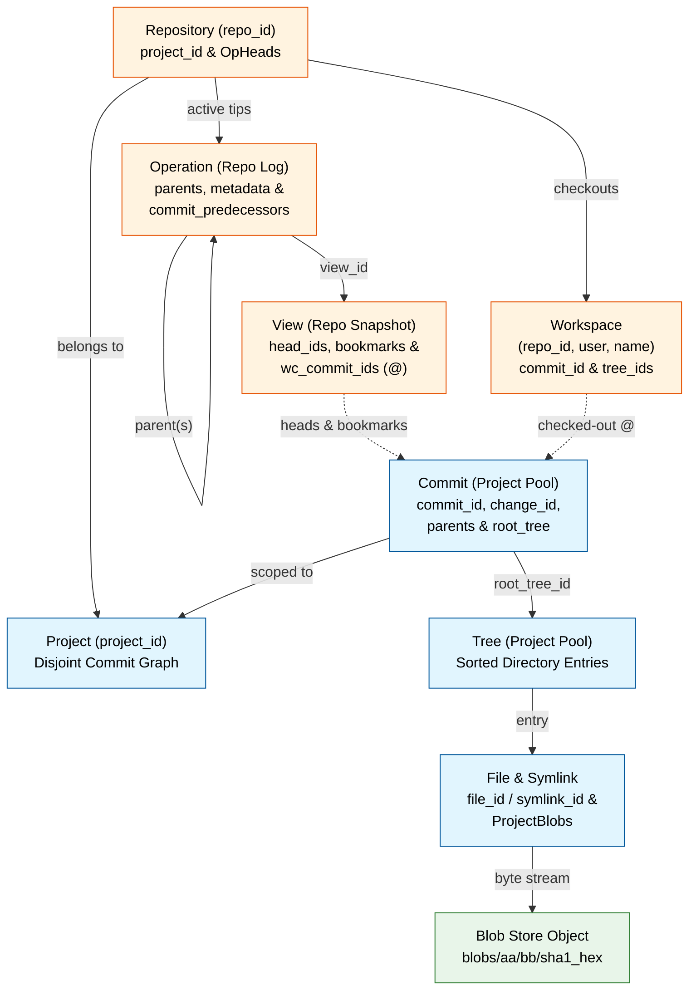
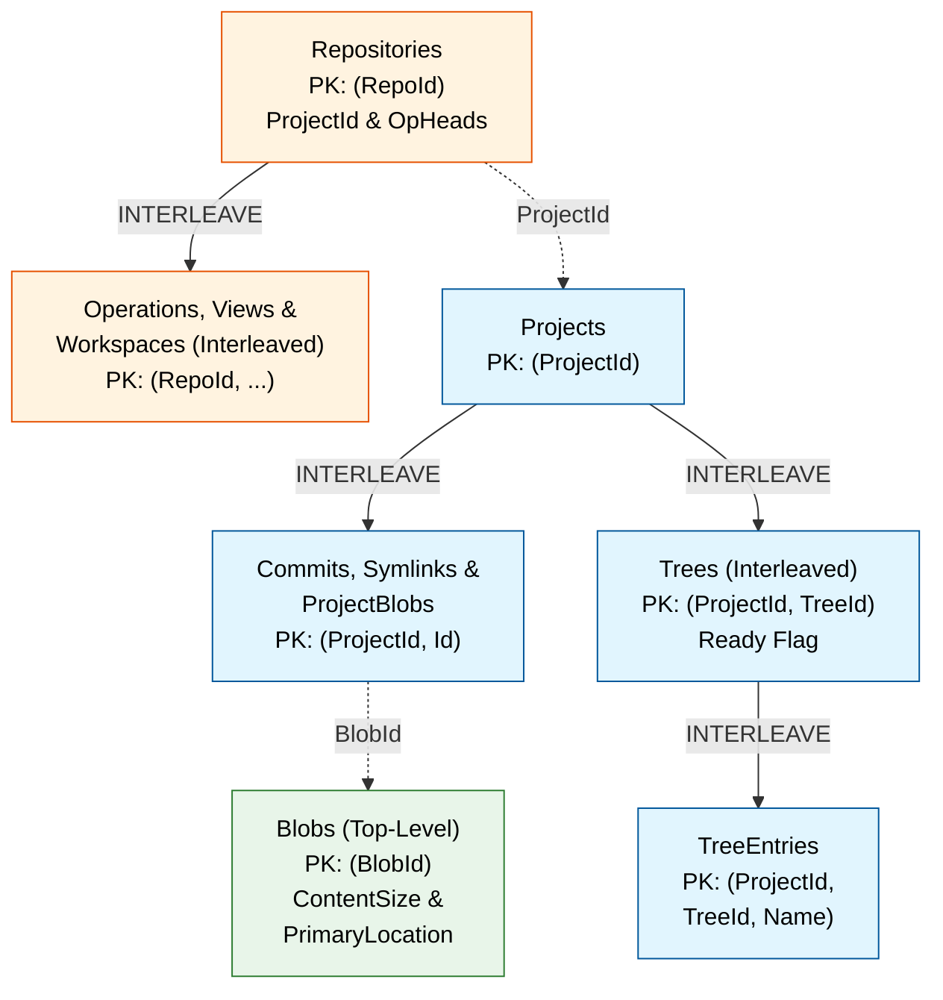

# Commit Cloud Data Model

## Summary

jj-commit-cloud represents [jj](https://github.com/jj-vcs/jj)'s core version control entities - commits, directory trees, files, symlinks, views, and operation logs - in remote cloud storage while preserving 20-byte Git SHA-1 object hashes in Milestone 1 via [gitoxide](https://github.com/GitoxideLabs/gitoxide) and preparing length-agile keys plus `Commit.external_ids` for future prolly-tree and tree-delta formats.

Data is organized across three scopes so a single Commit Cloud deployment can host many unrelated codebases alongside shared multi-agent workspaces:

* **Projects (`project_id`):** Own the immutable graph of commits, directory trees, symlinks, and file-ownership links. Unrelated codebases live in separate projects with disjoint commit graphs.
* **Repositories (`repo_id`):** Belong to a parent project and own the mutable per-repository state - active operation heads, the append-only operation log, view snapshots, and attached workspaces.
* **Global Content-Addressed Blobs (`BlobId`):** Deduplicate raw file byte streams by content hash in `BlobStore`, gated per project (`ProjectBlobs`) so projects never share file visibility unless both projects have written the file.

For generic jj concepts such as `ChangeId` versus `CommitId`, algebraic conflict arithmetic, bookmarks, and `jj undo`, see upstream's [Glossary](https://docs.jj-vcs.dev/latest/glossary/), [Operation Log](https://docs.jj-vcs.dev/latest/operation-log/), and [Technical Conflicts](https://docs.jj-vcs.dev/latest/technical/conflicts/); for overall system architecture, see [System Design](design.md).

## Multi-Repository Partitioning and Disjoint Histories

A local `.git/objects` directory stores objects for one repository on one machine, whereas Commit Cloud stores data for many repositories at once. Hosted repositories may be completely different codebases with no shared history, or they may be dozens of developer and agent sandboxes collaborating on the same codebase.

<!--
Diagram styling and update instructions:
- Uses Mermaid flowchart TD with quoted node labels and   line breaks within the page width. Per-repository operation-log entities use light orange (#fff3e0 / #e65100), project-scoped commit-graph entities use light blue (#e1f5fe / #01579b), and content-addressed blob storage uses light green (#e8f5e9 / #2e7d32).
- To update: edit the node or edge declarations below and run `jj fix -s @`.
-->

Suppose one Commit Cloud cluster hosts two unrelated codebases - `project_id = "kernel"` (`repo-kernel`) and `project_id = "webapp"` (`repo-alice` and `repo-agent-7`) - and both codebases happen to contain an identical `LICENSE` file with Git blob hash $B_L$:

* **Disjoint Commit Graphs Across Projects:** `"kernel"` commits and trees are keyed under `"kernel"`, while `"webapp"` commits and trees are keyed under `"webapp"`. Listing or resolving commits in `repo-alice` scans only `"webapp"`, never `"kernel"`.
* **Zero-Copy Sharing Within a Project:** When `repo-agent-7` writes a new commit $C_{w3}$ in `"webapp"`, `repo-alice` can inspect or cherry-pick $C_{w3}$ immediately without re-uploading any trees or files, while `repo-alice`'s bookmarks and operation log stay untouched until Alice chooses to reference $C_{w3}$.
* **Deduplicated Storage With Isolated Ownership:** `BlobStore` stores the bytes for $B_L$ once at `blobs/<aa>/<bb>/<B_L>`, while `ProjectBlobs` records separate `(kernel, B_L)` and `(webapp, B_L)` ownership rows. A third project `"firmware"` that has never uploaded $B_L$ receives `NOT_FOUND` if it attempts to read $B_L$.

## Core Entities and Relationships

### Operation

An operation represents a single state transition in a repository - such as snapshotting edited files, describing a change, rebasing a stack, or moving a bookmark. Operations form a per-repository directed acyclic graph in the operation log, recording start and end timestamps, user and host metadata, commit predecessor lineage (`commit_predecessors`), and a pointer to the resulting `View`. Each repository tracks its active tip operation IDs in `OpHeads`; under concurrent edits `OpHeads` holds multiple sibling IDs until reconciled into a merged operation.

### View

A view captures what a repository sees at a specific operation: its visible head commits (`head_ids`), local and remote bookmarks (`local_bookmarks` and `remote_bookmarks`, stored as added and removed commit lists so conflicting bookmark moves survive merges), and the current working-copy commit (`@`) for each workspace (`wc_commit_ids`). When a shared project pool accumulates hundreds of thousands of commits across developers and sandboxes, a repository's `View` acts as a compact filter defining the exact subgraph visible to `jj log` in that repository.

### Workspace

A workspace record in [workspace.proto](../common/proto/workspace.proto) tracks an attached local or virtual checkout keyed by `(repo_id, user, workspace_name)`. It records the checkout's materialized `commit_id`, `operation_id`, root `tree_ids` - preserving every side of a `Merge<TreeId>` when a conflicted commit is checked out alongside primary `tree_id` - and active `sparse_patterns`, letting tools and agent orchestrators inspect workspace health across machines.

### Commit

A commit is an immutable, insert-only snapshot in the commit graph. It records parent commit IDs (`parent_commit_ids`), rewrite predecessors (`predecessors`), logical `change_id`, commit description, author and committer signatures, optional cryptographic signature (`secure_sig`), and root directory tree (`root_tree_id`). A resolved commit stores one `TreeId`, whereas a commit containing an unresolved merge conflict stores an odd number $2N + 1$ of tree IDs alternating $N + 1$ positive and $N$ negative terms (`Merge<TreeId>`) alongside `conflict_labels`. Imported Git commits also retain their verified raw header bytes (`raw_git_commit`) and external VCS digest map (`external_ids`, such as `"git-sha1"`) for bit-for-bit Git export. Persistent metadata stores also record each commit's topological generation number ($\max(\text{parent generation}) + 1$, with $1$ for root-parented commits) to bound ancestry walks, along with secondary indexes on `ChangeId` and insertion order.

### Tree

A tree represents a single directory, mapping single-component entry names to child `TreeValue` targets: a regular or executable `File`, a `Symlink`, a child subdirectory `Tree`, or a Git submodule commit gitlink. `TreeId` is path-independent, matching upstream jj: two directories at different paths with identical entry names, modes, and child hashes share the same `TreeId`, and unmodified subdirectories are reused across commits without copying entries. Stored and cached `Tree` payloads keep entries sorted in `RepoPathComponent` UTF-8 byte order (`"foo" < "foo.rs"`) so `jj_lib`'s binary-search lookups work directly on the wire representation.

### File and Symlink

File and symlink entries form the leaves of a directory tree. Standard open-source `jj_lib` tree entries record only a file's content hash and executable bit, omitting file byte length - which would force virtual filesystems such as [jj-vfs](https://github.com/jj-vcs/jj-vfs) to open or stream every file in a directory just to answer `stat()` (`ls -l`). Commit Cloud tracks each blob's byte size (`ContentSize`) in `MetadataStore` and populates `File.size_bytes` on `ReadTree` responses without altering canonical Git tree hashes. Short UTF-8 symlink target paths live directly in `MetadataStore`, while file byte payloads live in `BlobStore`.

## Object Identity and Planned Hash Evolution

Canonical identifiers are computed and verified on the server in [server/src/hash_utils.rs](../server/src/hash_utils.rs) using the constants in [common/src/lib.rs](../common/src/lib.rs):

| Identifier | Size in M1 | Milestone 1 Canonical Digest | Virtual Root Constant |
| :--- | :--- | :--- | :--- |
| `FileId` | 20 bytes | Git `blob` SHA-1 (`"blob <len>\0" + content`) | None |
| `SymlinkId` | 20 bytes | Git `blob` SHA-1 over UTF-8 target path | None |
| `TreeId` | 20 bytes | Git `tree` SHA-1 over `<mode> <name>\0<20-byte oid>` entries sorted with trailing `/` on directories: `100644`/`100755` file, `120000` symlink, `40000` tree (`git ls-tree` displays `040000`), `160000` submodule | `EMPTY_TREE_ID` (`4b825dc642cb6eb9a060e54bf8d69288fbee4904`) |
| `CommitId` | 20 bytes | Git `commit` SHA-1 omitting synthetic all-zero root parent, with `change-id` (`z-k` reverse-hex), `jj:trees`, `jj:conflict-labels`, and `gpgsig` headers | `ROOT_COMMIT_ID` ($20$ zero bytes) |
| `ChangeId` | 16 bytes | Stable 128-bit logical change ID (rendered in `z-k` reverse-hex) | Root change ID (`zzzzzzzz...`) |
| `ViewId` | 16 bytes | First 16 bytes of SHA-1 over key-sorted, 8-byte length-prefixed `View` fields | `ROOT_VIEW_ID` ($16$ zero bytes) |
| `OperationId` | 16 bytes | First 16 bytes of SHA-1 over `view_id`, parents, sorted metadata attributes, and predecessors | `ROOT_OPERATION_ID` ($16$ zero bytes) |

Reads of the four virtual root constants (`ROOT_COMMIT_ID`, `EMPTY_TREE_ID`, `ROOT_VIEW_ID`, and `ROOT_OPERATION_ID`) are synthesized in memory without database lookups, with `ROOT_VIEW` exposing `head_ids = [ROOT_COMMIT_ID]` as every new repository's initial graph anchor.

### Decoupling Internal Hashes From External VCS Hashes

Addressing commits and trees by 20-byte Git SHA-1 digests makes Milestone 1 Git import and export translation-free, but Git's flat directory tree hash couples every `TreeId` and `CommitId` to an $O(N)$ serialization of all entries in a directory. Supporting prolly-tree directory nodes and compact tree-delta commits on wide monorepo directories requires decoupling Commit Cloud's canonical internal digests from Git's Merkle format:

* **Length-Agile Keys (`BYTES(64)`):** Database columns and Protocol Buffer fields store object IDs as variable-length byte slices up to 64 bytes rather than fixed 20-byte arrays.
* **Imported and Post-Hoc External IDs:** Following [Mononoke](https://github.com/facebookexperimental/mononoke)'s Bonsai changeset model and derived hash-mapping tables, commits carry an external-ID map (`external_ids` in [backend.proto](../common/proto/backend.proto)) keyed by VCS scheme (`"git-sha1"`, `"git-sha256"`, `"perforce-cl"`). Git imports record `"git-sha1"` at ingest; once native prolly-tree and tree-delta commits are enabled, commits authored in Commit Cloud will receive native internal IDs at write time and attach derived Git or Perforce hashes after the fact during export or background mirror sync.

## Comparison With Local Git Storage

Protocol Buffer contracts in [backend.proto](../common/proto/backend.proto), [op_store.proto](../common/proto/op_store.proto), and [workspace.proto](../common/proto/workspace.proto) carry jj's domain model across gRPC without flattening conflicts or rewrite history into lossy local files:

| Dimension | Local `GitBackend` (`.git/` + `.jj/`) | jj-commit-cloud |
| :--- | :--- | :--- |
| **Repository Hosting** | One repository per `.git/` directory on disk | Many disjoint projects and shared-pool repositories on one server |
| **Conflicts** | Stored in Git trees + `.jj/repo/store/extra/` sidecar tables | Stored natively as `Merge<TreeId>` (`root_tree_id`) and `RefTarget` add/remove lists |
| **File Metadata & Sizes** | Pure SHA-1 packfiles; reading byte size requires opening object headers | SHA-1 blobs gated per project; `File.size_bytes` returned inline on `ReadTree` |
| **Ancestry & Index Sync** | Computed locally in `.jj/repo/index/` | Stored `Generation` numbers plus watermark-incremental commit sync |
| **Operation Log & Heads** | Local files under `.jj/repo/op_store/` and `op_heads/` | Transactional database rows with lock-free sibling head preservation and server-side merge |

## Physical Storage Layout

### Cloud Spanner Interleaved Schema

[server/sql/spanner_schema.sql](../server/sql/spanner_schema.sql) co-locates parent and child rows under two top-level split roots so independent projects partition cleanly while high-frequency `OpHeads` transitions spread across UUID repository splits without hotspotting:

<!--
Diagram styling and update instructions:
- Uses Mermaid flowchart TD with at most two peer nodes per rank and   line breaks within the page width. Project-interleaved tables use light blue (#e1f5fe / #01579b), repository-interleaved tables use light orange (#fff3e0 / #e65100), and global blob metadata uses light green (#e8f5e9 / #2e7d32).
- To update: edit the table nodes or edges below when server/sql/spanner_schema.sql changes and run `jj fix -s @`.
-->

* **Staged Wide-Directory Writes (`Trees.Ready`):** Cloud Spanner caps a single transaction at 80,000 cell mutations. Directories up to 4,000 entries write `Trees` (`Ready = TRUE`) and all `TreeEntries` in one atomic batch; larger directories stage `Ready = FALSE`, stream 4,000-entry batches, and flip `Ready = TRUE` on the final batch so readers never see partial directories.
* **Prefix Scans and Secondary Indexes:** Short commit and operation hex prefixes convert to binary primary-key bounds $[a, b]$ ($a \le \mathit{Id} \le b$), while `CommitsByChangeId` resolves `z-k` change-ID prefixes and `CommitsByInsertedAt` drives incremental `ListCommits` cursors.

### SQLite and In-Memory Metadata Stores

[SqliteMetadataStore](../server/src/store/sqlitestore.rs) mirrors the same relational tables ([server/sql/sqlite_schema.sql](../server/sql/sqlite_schema.sql)) in single-file `WAL` mode, pairing one serialized writer connection (`IMMEDIATE` transactions) with a pool of concurrent read-only `WAL` connections. [MemoryMetadataStore](../server/src/store/memorystore.rs) holds equivalent in-memory maps for fast unit tests.

### Cloud Storage and Local Content-Addressed Blobs

Both [GcsBlobStore](../server/src/store/gcsblob.rs) and [LocalFsBlobStore](../server/src/store/localblob.rs) shard immutable file payloads under two-level hex prefixes (`blobs/<aa>/<bb>/<sha1_hex>`). Small files below the inline threshold live directly in `Blobs.InlineContent`, while larger files stream from local disk via `Seek` or from Cloud Storage via HTTP `Range` requests with conditional write-once uploads and cross-region origin fallback in [ReplicatedBlobStore](../server/src/store/replicatedblob.rs) (see [Cloud Spanner and Cloud Storage Architecture](spanner-and-gcs-design.md)).

### Workstation `.jj/` Layout

Because commits, trees, views, and operations live in Commit Cloud, a local workspace directory keeps minimal state on disk:

* **Backend Configuration (`.jj/repo/store/config.toml`):** Records `server_url` and `repo_id` (plus optional `project_id`) alongside `"commit_cloud"` type markers under `.jj/repo/`.
* **Local Commit Index (`.jj/repo/index/`):** Caches compact commit-graph segments synced from the server so local revset evaluation remains fast.
* **Working-Copy Stat Cache (`.jj/working_copy/`):** Tracks local file `stat` metadata for `LocalWorkingCopy` snapshot comparisons.
* **Local Daemon Cache (`$XDG_CACHE_HOME/jj-commit-cloud/`):** When [jj-cc-daemon](../daemon/) is active, immutable objects are cached on local disk alongside per-`(server, project_id)` reachability markers so sibling checkouts in the same project share warm hits while unrelated projects stay isolated.

## Write-Before-Publish Ordering

Every mutation writes child objects before any parent object that references them:

$$\text{File / Symlink} \longrightarrow \text{Tree} \longrightarrow \text{Commit} \longrightarrow \text{View} \longrightarrow \text{Operation} \longrightarrow \text{OpHeads}$$

1. **Crash Safety Without Dangling Pointers:** File bytes finish uploading to `BlobStore` before their metadata record is published, child blobs and subtrees exist before a parent `Tree` is accepted, and `View` plus `Operation` rows exist before `OpHeads` advances. An interrupted client or server leaves only unreferenced content-addressed objects, never a broken repository head.
2. **Lock-Free Sibling Preservation:** Concurrent `UpdateOpHeads` calls advancing from base $[O_1]$ to $O_2$ and $O_3$ remove $O_1$ and preserve both $[O_2, O_3]$ inside serializable transactions, allowing subsequent loads to merge both branches without lost work.
