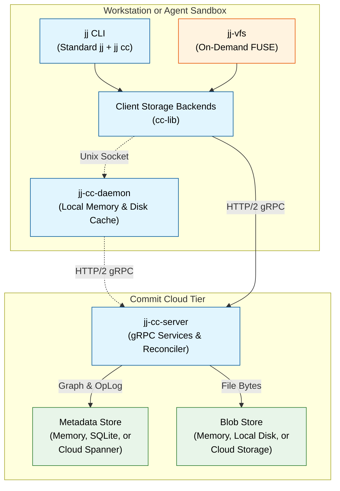
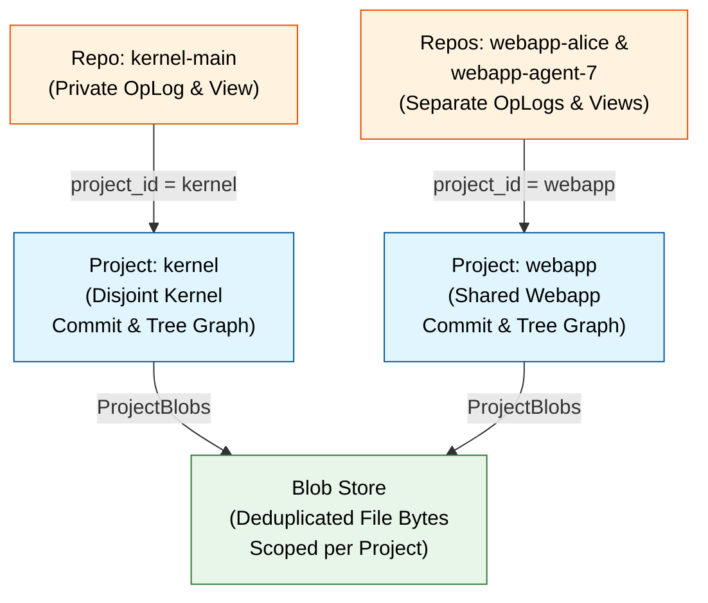

# jj-commit-cloud Design

## Summary

jj-commit-cloud stores a [jj](https://github.com/jj-vcs/jj) repository's commits, directory trees, file contents, and operation log in a [remote gRPC service](../server/) rather than inside a single machine's local `.git/` directory, pairing with [jj-vfs](https://github.com/jj-vcs/jj-vfs) for on-demand virtual workspaces while keeping upstream's local `GitBackend` intact inside the same [CLI binary](../cli/src/main.rs).

A single Commit Cloud deployment hosts any number of unrelated codebases with disjoint commit histories isolated into separate projects, while allowing multiple developer and coding-agent repositories within the same project to share one deduplicated pool of commits, trees, symlinks, and files. On the server, the [storage coordinator](../server/src/store/mod.rs) separates transactional graph metadata in memory, [SQLite](https://www.sqlite.org/), or [Cloud Spanner](https://cloud.google.com/spanner) from immutable file byte streams in memory, on local disk, or in [Cloud Storage](https://cloud.google.com/storage) with automatic origin fallback across regions. Together with server-side 3-way operation-head reconciliation, cloud-tracked workspace state, lossless Git history import and export, and an optional per-user [local caching daemon](../daemon/), this architecture lets human developers and automated agents share live repository state across machines without local repository locks. Commit Cloud uses standard 20-byte Git SHA-1 digests in Milestone 1 while keeping storage keys length-agile and recording external VCS digests following [Mononoke](https://github.com/facebookexperimental/mononoke)'s Bonsai changeset model, so future prolly-tree directories and tree deltas can evolve internal identifiers without losing Git compatibility. For entity relationships and physical storage schemas, see [Data Model](data-model.md).

## Context

### Background

Storing version control state inside a single machine's `.git/` directory works well for one person working in one checkout, yet local-disk storage runs into three structural limits when repositories grow large or when developers, IDEs, and coding agents work in parallel:

* **Repeated Clones Across Machines and Sandboxes:** Every new workstation, CI job, or short-lived agent sandbox must download packfiles onto local disk before reading a single file or authoring a change.
* **Filesystem Lock Contention and Blocking Conflicts:** Processes sharing a local checkout contend on `.git/index.lock` and reference locks, while merge conflicts write text markers onto disk and halt rebases mid-stack until resolved by hand.
* **Machine-Bound Work in Progress:** Unpushed commits, working-copy edits, and undo history exist only on the disk where they were created. Picking up an in-progress stack from a second machine - or letting an orchestrator or code-review surface inspect an agent's intermediate commits - requires pushing throwaway branches to a Git host.

### Core Tenets From jj

jj-commit-cloud builds on the architectural properties of upstream jj rather than inventing a separate version control model (see upstream's [Core Tenets](https://docs.jj-vcs.dev/latest/core_tenets/), [Architecture](https://docs.jj-vcs.dev/latest/technical/architecture/), and [Glossary](https://docs.jj-vcs.dev/latest/glossary/)):

* **Separation of Library and UI:** Core version control algorithms live in a standalone Rust library (`jj_lib`) with no terminal dependencies, allowing the exact same merge, rebase, and revset logic to run in the workstation CLI and inside jj-cc-server.
* **Storage-Independent Traits:** All persistence sits behind pluggable traits for commits, the operation log, operation heads, the commit index, and the working copy. Local repositories back those traits with `.git/` files; Commit Cloud backs them with gRPC calls.
* **Working Copy as a Commit:** The working directory is modeled as an ordinary commit (`@`). Commands snapshot modified files into `@` automatically before running, removing the staging area and dirty-checkout errors ([Working Copy](https://docs.jj-vcs.dev/latest/working-copy/)).
* **First-Class Conflicts:** Merge conflicts are stored algebraically inside commits as sums and differences of trees (`Merge<TreeId>`) rather than conflict markers on disk, allowing rebases to succeed and cascade to descendants ([Technical Conflicts](https://docs.jj-vcs.dev/latest/technical/conflicts/)).
* **The Operation Log as the Source of Truth:** Every change to visible heads, [bookmarks](https://docs.jj-vcs.dev/latest/bookmarks/), or `@` appends an immutable node to the [operation log](https://docs.jj-vcs.dev/latest/operation-log/) ([Concurrency](https://docs.jj-vcs.dev/latest/technical/concurrency/)), turning concurrent mutations into mergeable branches and making every action reversible with `jj undo`.

## Design

### System Overview

jj-commit-cloud makes two architectural shifts relative to a local jj repository:

1. **Remote History and Operation Logs:** Commits, directory trees, symlinks, file contents, views, and operations are persisted through jj-cc-server rather than inside `.jj/` on one machine, shrinking the local `.jj/` directory to backend configuration markers, an incremental commit index, and working-copy file `stat` caches.
2. **Views Decoupled From Large Commit Graphs:** A repository's view records only its visible head commits, bookmarks, and checked-out working-copy commits (`@`), acting as a small, fast window into a much larger cloud commit store so repositories remain accessible from any machine without downloading full history upfront.

<!--
Diagram styling and update instructions:
- Uses Mermaid flowchart TD with quoted node labels,   line breaks within the page width, and standard palette classes (#e1f5fe / #01579b for Commit Cloud components, #fff3e0 / #e65100 for VFS surfaces, and #e8f5e9 / #2e7d32 for storage backends).
- To update: edit the node or edge declarations below and run `jj fix -s @`.
-->

### Hosting Independent Codebases and Shared Project Pools

One Commit Cloud deployment serves an entire team or organization across many workspaces, whereas a local `.git/` directory serves a single checkout on one disk. Serving an organization requires supporting two distinct sharing patterns at the same time: hosting unrelated codebases whose histories never intersect, and letting dozens of humans and coding agents collaborate on the same codebase without duplicating its history.

jj-commit-cloud models both patterns through two explicit scopes in the [server storage layer](../server/src/store/mod.rs); see [Data Model](data-model.md) for table layouts:

1. **Projects (`project_id`) for Independent Commit Graphs:** Each project owns an isolated pool of immutable commits, directory trees, symlinks, and file-ownership links. Two unrelated codebases - such as an operating-system kernel and a billing web service - live in separate projects on the same Commit Cloud deployment with disjoint commit graphs and zero cross-project visibility. Initializing a repository without `--project-id` creates a dedicated project automatically, giving standalone repositories a private commit graph by default.
2. **Repositories (`repo_id`) for Isolated Views Over a Shared Pool:** Multiple repositories bound to the same project share every commit, tree, symlink, and file in that project's pool without re-uploading common history. At the same time, each repository keeps its own independent operation log, active operation heads, bookmarks, and `@` working-copy commits. File contents are stored once by content hash in `BlobStore`, gated by per-project ownership records (`ProjectBlobs`) so one project cannot read or probe files belonging to another project.

Consider three repositories hosted on one jj-cc-server cluster: `repo-kernel` in project `kernel`, and `repo-alice` plus `repo-agent-7` both in project `webapp`. Commits written in `repo-kernel` exist only inside `kernel`'s graph. When `repo-agent-7` snapshots an experimental stack in `webapp`, its commits and trees land in `webapp`'s shared pool: Alice's bookmarks and `jj log` output in `repo-alice` stay undisturbed, yet Alice or a code-review tool can inspect, diff, or rebase onto `repo-agent-7`'s commit immediately by commit ID without fetching packfiles.

<!--
Diagram styling and update instructions:
- Uses Mermaid flowchart TD with at most two peer nodes per rank to keep rendered width compact (#fff3e0 / #e65100 for per-repository views/oplogs, #e1f5fe / #01579b for project-scoped commit graphs, and #e8f5e9 / #2e7d32 for shared content-addressed blob storage).
- To update: edit the node or edge declarations below and run `jj fix -s @`.
-->

### Pluggable Storage Backends

jj selects how to open a repository by reading small type-marker files inside `.jj/repo/` and `.jj/working_copy/`. Creating or cloning a Commit Cloud workspace writes `"commit_cloud"` into those markers and records the server URL and repository ID in `.jj/repo/store/config.toml`. Standard `jj` commands run inside that directory then dispatch to the [client library](../lib/) implementations below, while ordinary Git repositories continue using `GitBackend`:

| Subsystem | Upstream Trait | Commit Cloud Implementation | Upstream Default | Responsibility |
| :--- | :--- | :--- | :--- | :--- |
| **Commit Backend** | [Backend](https://github.com/jj-vcs/jj/blob/v0.43.0/lib/src/backend.rs) | [CommitCloudBackend](../lib/src/cc_backend.rs) | [GitBackend](https://github.com/jj-vcs/jj/blob/v0.43.0/lib/src/git_backend.rs) | Reads and writes commits, directory trees, files, symlinks, and submodule gitlinks over gRPC. |
| **Operation Store** | [OpStore](https://github.com/jj-vcs/jj/blob/v0.43.0/lib/src/op_store.rs) | [CommitCloudOpStore](../lib/src/cc_op_store.rs) | [SimpleOpStore](https://github.com/jj-vcs/jj/blob/v0.43.0/lib/src/simple_op_store.rs) | Reads and writes operation log entries and repository view snapshots on the server. |
| **Operation Heads** | [OpHeadsStore](https://github.com/jj-vcs/jj/blob/v0.43.0/lib/src/op_heads_store.rs) | [CommitCloudOpHeadsStore](../lib/src/cc_op_heads_store.rs) | [SimpleOpHeadsStore](https://github.com/jj-vcs/jj/blob/v0.43.0/lib/src/simple_op_heads_store.rs) | Tracks, reconciles, and advances the repository's active tip operation IDs. |
| **Commit Index** | [IndexStore](https://github.com/jj-vcs/jj/blob/v0.43.0/lib/src/index.rs) | [CommitCloudIndexStore](../lib/src/cc_index_store.rs) | [DefaultIndexStore](https://github.com/jj-vcs/jj/blob/v0.43.0/lib/src/default_index/store.rs) | Syncs new commits from the shared project pool into `.jj/repo/index/` so revsets evaluate locally. |
| **Working Copy** | [WorkingCopy](https://github.com/jj-vcs/jj/blob/v0.43.0/lib/src/working_copy.rs) | [CommitCloudWorkingCopy](../lib/src/cc_working_copy.rs) | [LocalWorkingCopy](https://github.com/jj-vcs/jj/blob/v0.43.0/lib/src/local_working_copy.rs) | Materializes files on local disk while syncing the workspace's checked-out commit, trees, and sparse patterns to the server. |

Upstream's CLI runner drives async storage traits with a lightweight single-future executor (`pollster`) rather than a Tokio runtime. To run HTTP/2 gRPC streams efficiently across that boundary, the [client runtime bridge](../lib/src/util.rs) maintains a shared background multi-thread Tokio runtime and pools one multiplexed HTTP/2 connection per server endpoint so parallel tree and file fetches pipeline over a single connection.

On the server side, jj-cc-server links the same `jj_lib` crate alongside [in-process storage adapters](../server/src/jj_lib_adapters.rs) backed directly by the server's database coordinator. Whenever concurrent writers create divergent operation heads, the server runs jj's native 3-way view merge directly against storage without round-tripping intermediate trees through a client.

### Client Commands and Workflows

The [custom CLI](../cli/src/commands/) adds a `jj cc` subcommand family for cloud lifecycle tasks while leaving everyday version control commands unchanged:

* **Initializing and Attaching Workspaces (`jj cc init`):** Creates a local workspace backed by a remote Commit Cloud repository (`--create` allocates a new repository on the server, optional `--project-id` joins an existing shared project pool, and `--repo-id` attaches a new workspace to an existing cloud repository). Once initialized, everyday work uses unmodified upstream commands (`jj status`, `jj diff`, `jj new`, `jj describe`, `jj rebase`, `jj squash`, `jj undo`).
* **Cloning and Checking Out Revisions (`jj cc clone`):** Creates a fresh local workspace attached to an existing remote repository, reconciles any concurrent remote operation heads, synchronizes the commit index, and materializes either the repository's latest tip or a requested historical revision (`-r <revision>`) onto disk.
* **Inspecting Cloud Workspaces (`jj cc workspace`):** Lists all workspaces registered against a cloud repository across users and machines (`list`), reports the commit, operation, and tree a workspace last recorded and whether that tree matches the commit (`status`), and removes retired sandbox registrations (`delete`).
* **Importing and Exporting Git History (`jj cc import-git` and `jj cc export-git`):** Migrates an existing local or bare Git repository into Commit Cloud with identical 20-byte SHA-1 hashes and branch bookmarks, or materializes a Commit Cloud repository's commits, trees, symlinks, submodules, and bookmarks back into a standard Git object directory.
* **Managing the Local Cache (`jj cc daemon`):** Enables or disables transparent routing through the per-user local caching proxy (`enable`, `disable`), inspects live L1 memory and L2 disk cache hit rates (`status`), and manages daemon lifecycle (`start`, `stop`, `clear-cache`).

### Life of a Command

Tracing a routine edit shows how the client, cache, and server cooperate. Suppose a developer initializes a workspace with `jj cc init`, edits `src/lib.rs` on disk, and runs `jj describe -m "add parser"`:

1. **Loading and Reconciling the Repository Head:** At startup, the operation-heads backend asks jj-cc-server for the repository's active head (routing through the local daemon when enabled). If only one head is active, the server returns it directly; if parallel writers produced sibling operation heads $[O_1, O_2]$, the server merges their views into $[O_3]$ first. The client then reads that operation and its view to learn the visible heads, bookmarks, and current `@` commit.
2. **Catching Up the Local Commit Index:** Next, the commit-index backend checks whether any new commits were added to the shared project pool since its last sync watermark - for example by a teammate, an agent sandbox, or a Git import. Any unseen commits are fetched in parent-first order and appended to `.jj/repo/index/` so local revset queries can traverse them; when the project graph is unchanged, zero commit fetches are needed.
3. **Snapshotting the Working Directory:** Before running `describe`, jj snapshots local filesystem edits into `@`. Comparing file `stat` metadata against `.jj/working_copy/` reveals that `src/lib.rs` changed; the client streams the modified file to jj-cc-server to obtain its Git SHA-1 `FileId`, writes the updated ancestor directory `Tree` objects bottom-up, and writes a rewritten `@` commit carrying the same logical `ChangeId`.
4. **Publishing the Transaction:** `jj describe` writes a new commit with the `"add parser"` description and records the previous `@` snapshot as its predecessor. To commit the transaction in write-before-publish order, jj persists the updated `View` and `Operation` and advances the repository's active operation heads on the server, and records the workspace's updated commit, tree, and sparse checkout state in `WorkspaceService`.

### Server Storage, Hashing, and Operation Reconciliation

Placing stateless jj-cc-server instances in front of storage centralizes canonical hashing, referential integrity checks, and lock-free operation-head coordination.

Clients send structured object fields on writes - plus optional raw Git headers during `import-git` - and the server's [hashing module](../server/src/hash_utils.rs) computes and verifies canonical digests before storing immutable, insert-only records. Files, symlinks, submodule gitlinks, directory trees, and commits use standard 20-byte Git SHA-1 digests via [gitoxide](https://github.com/GitoxideLabs/gitoxide) matching upstream `GitBackend`. Git tree hashes apply Git's trailing-slash directory rule while stored tree entries stay sorted by `RepoPathComponent` UTF-8 name order (`"foo" < "foo.rs"`) for binary search in `jj_lib`; commit hashes omit jj's synthetic all-zero root parent and encode jj metadata in standard Git extra headers (`change-id`, `jj:trees`, `jj:conflict-labels`, and cryptographic signatures). `View` and `Operation` records hash to deterministic 16-byte SHA-1 prefixes over sorted, length-prefixed fields.

Commit graphs and raw file contents place very different demands on storage: commits, trees, views, and operation heads are small structured records requiring serializable transactions and index scans, whereas file payloads are immutable byte streams that can span megabytes or gigabytes. [CompositeStore](../server/src/store/mod.rs) separates `MetadataStore` - backed by [in-memory maps](../server/src/store/memorystore.rs), [WAL-mode SQLite](../server/src/store/sqlitestore.rs) with pooled concurrent readers, [Cloud Spanner and Spanner Omni](../server/src/store/spannerstore.rs) - from `BlobStore` - backed by in-memory buffers, [local content-addressed files](../server/src/store/localblob.rs), [Cloud Storage](../server/src/store/gcsblob.rs) wrapped in [replicated blob routing](../server/src/store/replicatedblob.rs) for cross-region lag recovery. Before publishing any parent tree or commit, `CompositeStore` verifies child dependencies in batched queries and enriches directory entries with file byte sizes; see [Cloud Spanner and Cloud Storage Architecture](spanner-and-gcs-design.md) for schema locality and cross-region consistency details.

When two clients start from operation $O_0$ and publish $O_1$ and $O_2$ concurrently, serializable `UpdateOpHeads` transactions retain both sibling heads $[O_1, O_2]$ instead of failing or overwriting either client. On the next load, the [reconciliation engine](../server/src/reconcile_op_heads.rs) coalesces concurrent callers for that repository, runs `jj_lib`'s 3-way view merge in-process against storage, and swaps $[O_1, O_2] \to [O_3]$ via compare-and-swap.

### Local Caching Daemon

Every CLI command is a short-lived process that reads commits, directory trees, views, and files in sequence; repeating cold network roundtrips across workspaces on the same machine adds avoidable latency over WAN links.

Enabling the per-user [local caching daemon](../daemon/) routes `BackendService`, `OpStoreService`, and `WorkspaceService` over a local Unix domain socket on Linux and macOS or loopback TCP on Windows, auto-spawning the daemon on demand and falling back to direct HTTP/2 if unavailable. Inside the daemon, a [two-tier cache](../daemon/src/cache.rs) stores immutable content-addressed objects across a byte-bounded in-memory LRU and an atomic local disk cache under `$XDG_CACHE_HOME/jj-commit-cloud`. Concurrent cold misses on the same object coalesce onto a single upstream fetch, and cached objects stay partitioned by server endpoint and repository ID so unrelated projects on the same host never leak objects across boundaries. Mutable head and workspace transitions forward straight to jj-cc-server over pooled HTTP/2 channels.

### Working Copies and Virtual Filesystems

[CommitCloudWorkingCopy](../lib/src/cc_working_copy.rs) delegates local file materialization, `stat` caching, and sparse-checkout evaluation to upstream's `LocalWorkingCopy` while syncing each workspace's checked-out commit, operation, root trees - preserving every side of a conflicted `Merge<TreeId>` checkout - and sparse patterns to [WorkspaceService](../server/src/workspace.rs). If a workspace's `@` commit is rewritten from another machine or by an agent, the operation recorded in `.jj/working_copy/` diverges from the server's current view, allowing jj to detect the stale checkout and prompt `jj workspace update-stale`.

For large repositories where materializing files on disk is unnecessary, pairing `jj sparse set --clear` with [jj-vfs](https://github.com/jj-vcs/jj-vfs) mounts trees lazily over FUSE: directory reads return inline file byte sizes so `stat()` and `ls -l` require no extra RPCs, wide directories stream via cursor pagination, short commit and change prefixes resolve on the server, and partial file reads stream requested byte ranges directly.

### Bridging Commit Cloud and Git

Teams can adopt Commit Cloud incrementally without breaking existing Git history, CI pipelines, or code-review tools that reference Git commit SHAs.

Running `jj cc import-git` invokes the [Git bridge](../lib/src/git_bridge.rs), which walks multi-branch and merge commit graphs in topological parent-first order, reads each unique file blob and uploads it in 64 KiB frames, uploads symlinks and submodule gitlinks, preserves exact raw Git commit headers alongside `"git-sha1"` external IDs, and publishes local and remote branch bookmarks in one atomic operation. Running `jj cc export-git` reconstructs standard Git blobs, symlinks, submodule gitlinks, trees, commits, and branch refs verified against every 20-byte SHA-1 digest so `git fsck --full` passes with zero hash translation, and skips bookmarks whose names are not valid Git branch names. See upstream's [Git Compatibility](https://docs.jj-vcs.dev/latest/git-compatibility/) guide for how jj represents bookmarks and conflicted commits in Git.

## Quality Attributes

### Data Integrity and Concurrency

Storing repository state in jj's append-only operation log eliminates `.lock` file races and corrupted working-copy indexes. Every mutation writes objects bottom-up - files and symlinks first, then directory trees, commits, views, and operations, and finally active operation heads - while commits are insert-only once written. If a client or server crashes mid-command, unreferenced objects remain inert and active repository heads stay consistent.

### Security and Multi-Repository Isolation

Transport encryption uses TLS (`https://`) with native root certificates, and [server authentication](../server/src/auth.rs) supports constant-time Bearer token verification with multi-token rotation across all gRPC services while keeping health probes open for container orchestrators. Independent projects on the same Commit Cloud deployment maintain disjoint commit graphs and per-project blob ownership records, ensuring a caller in one project cannot read or probe whether another project holds a given file hash.

### Scalability and Latency

Stateless jj-cc-server replicas scale horizontally in front of shared storage, batching tree dependency checks into constant query rounds, streaming large files in 64 KiB chunks, and syncing client commit indexes incrementally from persisted watermarks rather than rescanning full repository history.

### Testability

Hermetic integration suites under [cli/tests/](../cli/tests/) and [server/tests/](../server/tests/) alongside `cargo xtask smoke` exercise ephemeral servers, local Cloud Spanner and Cloud Storage emulators, concurrent multi-agent races, and Git `fsck` round-trips without external cloud credentials.

## Vision and Future Directions

> [!NOTE]
> The capabilities below describe planned evolutions beyond the current Milestone 1 implementation.

### Decoupling Internal Hashes for Prolly Trees and Tree Deltas

Using 20-byte Git SHA-1 digests as canonical `CommitId` and `TreeId` identifiers gives Milestone 1 zero-translation Git round-tripping, yet Git's flat Merkle tree format hashes a directory by concatenating every entry in that directory. Modifying a single file inside a 100,000-entry directory therefore re-serializes and re-hashes the entire directory manifest.

To support sub-linear wide-directory updates via content-defined prolly trees and compact tree deltas, Commit Cloud decouples its physical storage schema from Git's Merkle wire format: object-ID columns use length-agile `BYTES(64)` keys, repository registration carries an explicit hash-algorithm selector, and `Commit.external_ids` maps VCS scheme names (`"git-sha1"`, `"git-sha256"`, `"perforce-cl"`) to external commit digests. Modeled on [Mononoke](https://github.com/facebookexperimental/mononoke)'s internal Bonsai changesets and derived hash-mapping tables, commits authored natively over prolly trees or tree deltas can use fast Commit Cloud digests internally while recording imported VCS hashes at ingest or deriving and attaching Git commit hashes after the fact on export.

### Asynchronous Daemon Write Outbox and Push Invalidations

Today [jj-cc-daemon](../daemon/) caches reads across memory and local disk and writes synchronously through to jj-cc-server. Extending the daemon with a durable on-disk write outbox (`WorkLog`), background topological flushing, and server-pushed operation-head invalidations (`WatchRepo`) will hide WAN write latency during rapid local command chains and keep warm caches synchronized across machines.

### Server-Only Command Execution and Continuous VCS Bridges

Running rebases, squashes, and history rewrites directly inside jj-cc-server for thin CLI clients and cloud coding agents avoids transferring intermediate trees to agent sandboxes, while continuous background Git and Perforce indexers will keep Commit Cloud synchronized with external hosts in near-real time.

### Fine-Grained Access Control and Agent Context (`jj-meta`)

Enterprise deployments will layer pluggable OAuth/OIDC identity providers and per-repository and path-level ACLs onto `MetadataStore`, alongside an optional companion metadata plane (`jj-meta`) linking commits, changes, and operations to agent prompts, reasoning traces, and verification results without altering commit hashes.
