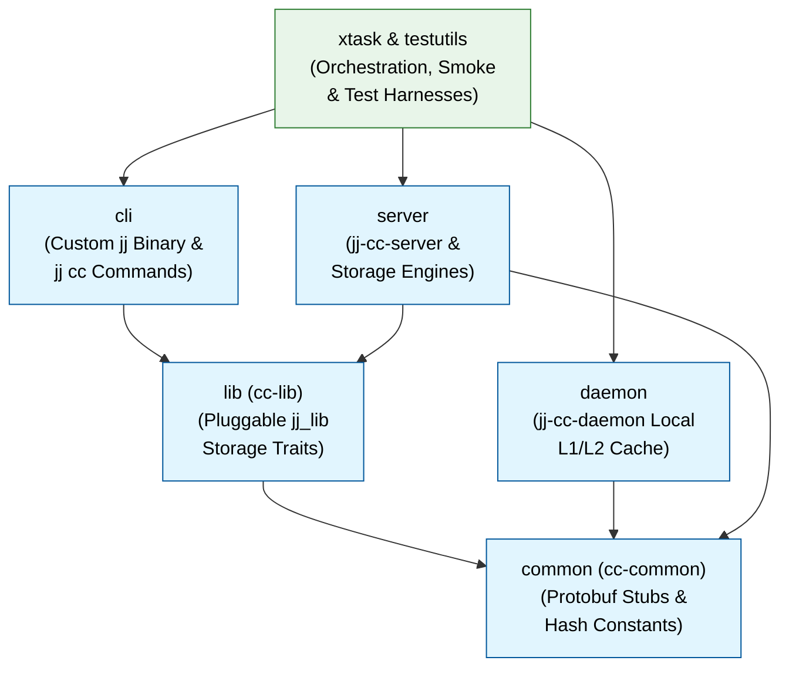
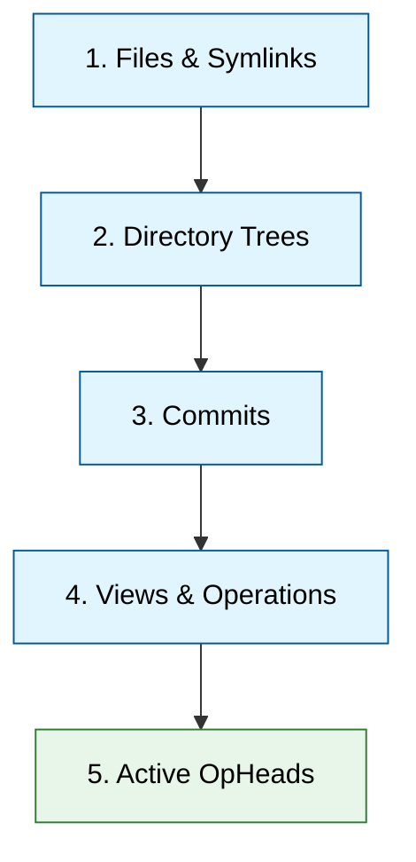
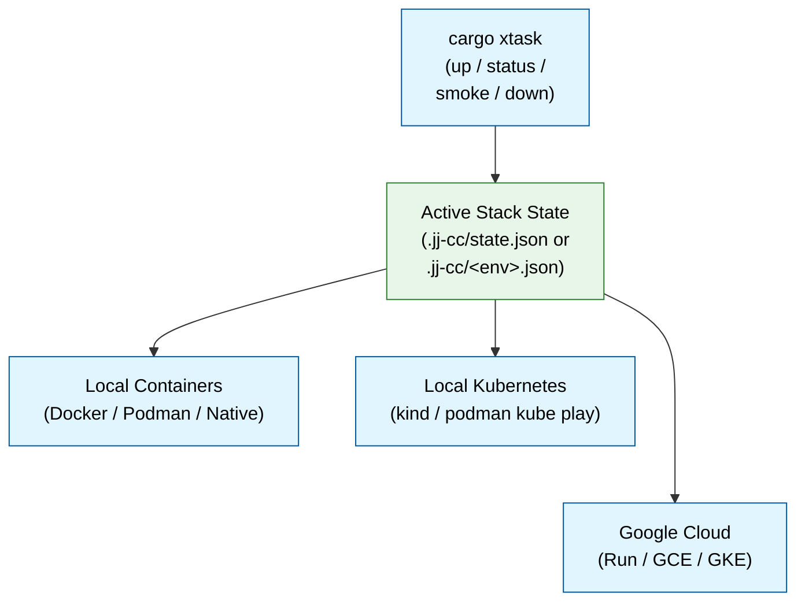
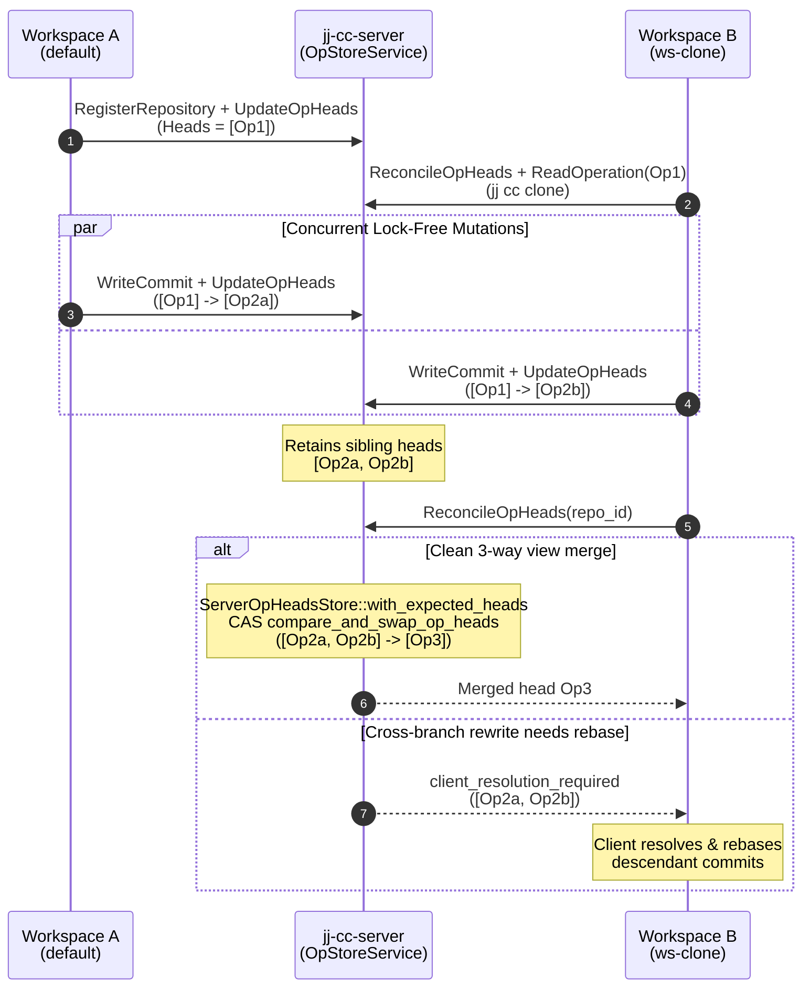
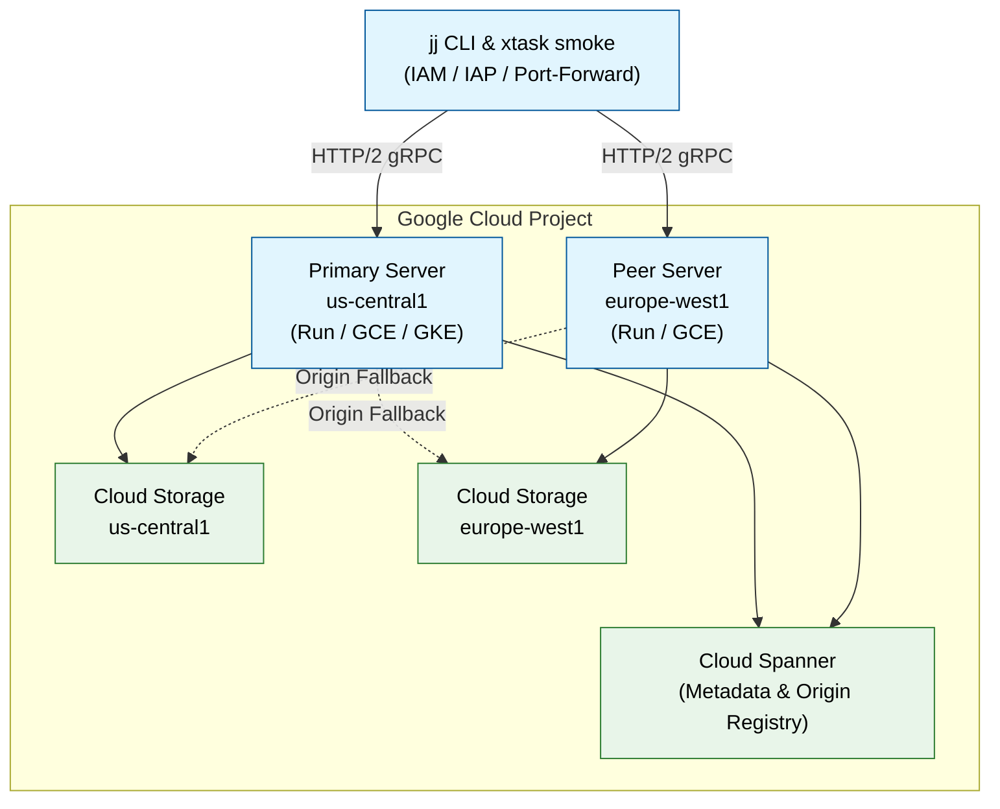

# Developer and Deployment Guide

## Summary

jj-commit-cloud builds as a Cargo workspace producing four binaries: jj-cc-server (the remote gRPC storage service), a custom [jj](https://github.com/jj-vcs/jj) CLI with `jj cc` subcommands, jj-cc-daemon (an optional per-user two-tier caching proxy), and a cross-platform `cargo xtask` workflow driver. Contributors build and test on the host with `cargo`, run containerized stacks via [compose.yaml](../compose.yaml) or [deploy/k8s/](../deploy/k8s/), or deploy single-region and multi-region stacks to Google Cloud, then verify checkouts with `cargo xtask smoke`.

For the conceptual architecture and domain schemas, read [System Design](design.md) and [Data Model](data-model.md) first.

## Workspace Crate Layout

<!--
Diagram styling and update instructions:
- Uses Mermaid flowchart TD with quoted node labels, <br/> line breaks that keep the diagram within the page width, and standard palette classes (#e1f5fe fill, #01579b border for active components; #e8f5e9 fill, #2e7d32 border for storage backends).
- To update: edit the node or edge declarations below and preview the rendered Mermaid block in Markdown.
-->


Workspace members declared in [Cargo.toml](../Cargo.toml):

* **Protocol Definitions ([common](../common/)):** Compiles [common/proto/backend.proto](../common/proto/backend.proto), [common/proto/op_store.proto](../common/proto/op_store.proto), and [common/proto/workspace.proto](../common/proto/workspace.proto) into `tonic` client and server stubs and exports digest-length and virtual-root constants.
* **Client Storage Adapters ([lib](../lib/)):** Implements `jj_lib`'s `Backend`, `OpStore`, `OpHeadsStore`, `IndexStore`, and `WorkingCopy` traits, plus Git import and export, over gRPC.
* **Commit Cloud Server ([server](../server/)):** Hosts jj-cc-server, canonical object hashing, server-side operation-head reconciliation, and pluggable storage adapters.
* **Local Caching Proxy Daemon ([daemon](../daemon/)):** Builds jj-cc-daemon, which caches immutable objects across an L1 memory LRU and an L2 local disk cache. `BackendService` objects (`Commit`, `Tree`, `Symlink`, `File`) are partitioned by `(server, project_id)` and `OpStoreService` objects (`View`, `Operation`) by `(server, repo_id)`, isolated by caller auth fingerprint.
* **Custom CLI Binary ([cli](../cli/)):** Embeds `jj_cli` registered with the Commit Cloud backend factories and the `jj cc` command family.
* **Test Harness ([testutils](../testutils/)):** Compiles jj-cc-server and jj-cc-daemon during `cargo test` and manages ephemeral test servers and emulators.
* **Workflow Driver ([xtask](../xtask/)):** Implements `cargo xtask build`, `up`, `status`, `smoke`, `bench`, and `down` in Rust across Linux, macOS, and Windows without requiring `make` or Bash scripts.

## Building and Running Tests

[rust-toolchain.toml](../rust-toolchain.toml) sets `channel = "stable"`, with `jj-lib` 0.47 requiring MSRV `1.97.1`. The `common` crate compiles under Rust edition 2021, while the other workspace crates use edition 2024. [.cargo/config.toml](../.cargo/config.toml) registers the `cargo xtask` alias and Windows stack-size flags. [common/build.rs](../common/build.rs) falls back to a vendored `protoc` when none is installed on the host, and the multi-target [Dockerfile](../Dockerfile) builds server, CLI, and binary-export images.

```bash
# Host workspace build and full automated test suite:
cargo build --workspace
cargo test --workspace

# Containerized build via Docker or Podman:
cargo xtask build --container --export-bin
```

### Protobuf Service Contracts

Editing [common/proto/backend.proto](../common/proto/backend.proto), [common/proto/op_store.proto](../common/proto/op_store.proto), and [common/proto/workspace.proto](../common/proto/workspace.proto) triggers automatic stub regeneration in [common/src/lib.rs](../common/src/lib.rs) during `cargo build`. All mutations follow bottom-up referential order so readers never encounter dangling object IDs:

<!--
Diagram styling and update instructions:
- Uses Mermaid flowchart TD with quoted node labels, <br/> line breaks that keep the diagram within the page width, and standard palette classes (#e1f5fe fill, #01579b border for active components; #e8f5e9 fill, #2e7d32 border for storage backends).
- To update: edit the node or edge declarations below and preview the rendered Mermaid block in Markdown.
-->


## Extending Storage Backends

Graph metadata and raw file byte streams have distinct consistency and scaling requirements. [server/src/store/mod.rs](../server/src/store/mod.rs) isolates them behind two async traits coordinated by `CompositeStore`:

* **Metadata Backend (`MetadataStore`):** Persists repository registration, commits, directory trees, symlinks, views, operations, serializable `update_op_heads` and `compare_and_swap_op_heads` transitions, and `(project_id, blob_id)` reachability records.
* **Blob Backend (`BlobStore`):** Writes and reads content-addressed file bytes (`put_blob`, `get_blob`, and byte-ranged `get_blob_range_with_record`), deduplicating identical file payloads while preserving read isolation.
* **Write-Before-Publish Coordination (`CompositeStore`):** Uploads file bytes to `BlobStore` before publishing metadata records and verifies child blobs, symlinks, subtrees, parent commits, views, and operations before accepting parent writes, mapping typed `StoreError` variants to gRPC status codes.

## Launching Topologies With `cargo xtask` and Compose

`cargo xtask up [mode]` (defaulting to `sqlite`) records the active topology, ownership metadata, and endpoint URLs in `.jj-cc/state.json` for the `default` slot or `.jj-cc/<name>.json` for named `--env <name>` slots (`state` is reserved). `cargo xtask status`, `cargo xtask smoke`, `cargo xtask bench`, and `cargo xtask down` read that state file without extra flags:

<!--
Diagram styling and update instructions:
- Uses Mermaid flowchart TD with quoted node labels, <br/> line breaks that keep the diagram within the page width, and standard palette classes (#e1f5fe fill, #01579b border for active components; #e8f5e9 fill, #2e7d32 border for storage backends).
- To update: edit the node or edge declarations below and preview the rendered Mermaid block in Markdown.
-->


| Mode | Backing Storage | Runtime | Launch Command |
| :--- | :--- | :--- | :--- |
| `memory` | In-memory metadata and blobs | Docker / Podman (or `--driver=native`) | `cargo xtask up memory` |
| `sqlite` (default) | SQLite `WAL` + local disk blob store | Docker / Podman (or `--driver=native`) | `cargo xtask up` or `cargo xtask up sqlite` |
| `postgres` | PostgreSQL 17 + MinIO (S3-compatible) + `/statz` on `:50052` | Docker / Podman (or `--driver=native` with `POSTGRES_URL`) | `cargo xtask up postgres` |
| `spanner` | Cloud Spanner Emulator + `fake-gcs-server` (or local disk with `--driver=native`) | Docker / Podman (or `--driver=native` with local Spanner emulator) | `cargo xtask up spanner` |
| `multiregion` | Shared Spanner Emulator + two regional buckets (`:8081` US, `:8082` EU) | Docker / Podman (`fake-gcs-server`) or `--driver=native` (local Spanner emulator + peer dirs) | `cargo xtask up multiregion` |
| `k8s` | Alias for `k8s-spanner` | `kind` + `kubectl` port-forward or `podman kube play` | `cargo xtask up k8s` |
| `k8s-memory` | In-memory server pod (`ClusterIP`) | `kind` + `kubectl` port-forward or `podman kube play` | `cargo xtask up k8s-memory` |
| `k8s-sqlite` | SQLite server pod with `PersistentVolumeClaim` (`ClusterIP`) | `kind` + `kubectl` port-forward or `podman kube play` | `cargo xtask up k8s-sqlite` |
| `k8s-postgres` | PostgreSQL 17 + MinIO + server pod (`ClusterIP`, `:8080` + `:50052`) | `kind` + `kubectl` port-forward or `podman kube play` | `cargo xtask up k8s-postgres` |
| `k8s-spanner` | Spanner Emulator + `fake-gcs-server` + server pod (`ClusterIP`) | `kind` + `kubectl` port-forward or `podman kube play` | `cargo xtask up k8s-spanner` |
| `k8s-multiregion` | Two-region server pod (`:8081` US, `:8082` EU, `ClusterIP`) | `kind` + `kubectl` port-forward or `podman kube play` | `cargo xtask up k8s-multiregion` |
| `cloud-run` | Managed Cloud Spanner + Cloud Storage | Serverless Cloud Run (HTTP/2 + IAM, optional `--peer-region`) | `cargo xtask up cloud-run --project <ID>` |
| `gce` | Managed Cloud Spanner + Cloud Storage | Compute Engine VM + IAP TCP tunnel (optional `--peer-region`) | `cargo xtask up gce --project <ID>` |
| `gke` | Managed Cloud Spanner + Cloud Storage | GKE Autopilot + Workload Identity + bearer Secret + `kubectl port-forward` | `cargo xtask up gke --project <ID>` |

On machines without a local Rust toolchain (or when running container engines without `cargo xtask`), the [Dockerfile](../Dockerfile), [compose.yaml](../compose.yaml), and [deploy/k8s/](../deploy/k8s/) manifests run standalone with `docker` or `podman`:

```bash
# Standalone Docker or Podman containers (no Compose plugin required):
CONTAINER=docker   # or: CONTAINER=podman
$CONTAINER build --target server -t jj-cc-server:local .
$CONTAINER build --target cli -t jj-cc-cli:local .
$CONTAINER network create jj-cc-net
$CONTAINER run -d --name jj-cc-server --network jj-cc-net -p 127.0.0.1:8080:8080 \
  -e JJ_CC_ALLOW_UNAUTHENTICATED=true \
  -e STORE_TYPE=sqlite -e BLOB_STORE=local -e SQLITE_PATH=/data/commit_cloud.db -e BLOB_PATH=/data/blobs jj-cc-server:local
$CONTAINER run --rm --network jj-cc-net --entrypoint xtask jj-cc-cli:local \
  smoke --jj-bin /usr/local/bin/jj --server http://jj-cc-server:8080
$CONTAINER rm -f jj-cc-server && $CONTAINER network rm jj-cc-net

# Docker Compose (requires the `docker compose` plugin):
docker compose --profile postgres up -d --build
# Or: docker compose --profile spanner up -d --build
docker compose --profile smoke run --rm smoke
docker compose down -v

# Local Kubernetes via Podman (`podman kube play`, no Compose plugin or `kind` required):
# For PostgreSQL under Podman, prefer `cargo xtask up k8s-postgres --k8s-provider podman-kube`
# so xtask waits for Postgres initdb and restarts jj-cc-server if it exits on cold start.
podman kube play deploy/k8s/spanner.yaml
podman kube down deploy/k8s/spanner.yaml
```

### Concurrent Operation-Head Reconciliation Flow

When two workspaces mutate the same cloud repository in parallel, jj-cc-server retains both sibling operation heads and reconciles them on the next load via pinned-snapshot compare-and-swap (`ServerOpHeadsStore::with_expected_heads` backed by `compare_and_swap_op_heads`), falling back to `client_resolution_required` when cross-branch commit rewrites require client-side descendant rebasing:

<!--
Diagram styling and update instructions:
- Uses Mermaid sequenceDiagram with <br/> line breaks in participant labels and messages to keep horizontal width compact; the init directive narrows participant boxes and margins so every participant fits the page width.
- To update: edit the sequence steps below and preview the rendered Mermaid block in Markdown.
-->


## End-to-End Client Walkthrough

Start a local server, author revisions across two workspaces, exercise Git round-tripping, and test both the per-user caching daemon and the isolated multi-agent benchmark:

```bash
# Start a local Commit Cloud stack:
cargo xtask up sqlite

# Create a cloud repository and author two revisions in Workspace 1:
cargo run -p cli -- cc init --server http://127.0.0.1:8080 --create /tmp/ws1
printf 'pub const VERSION: &str = "v1";\n' > /tmp/ws1/lib.rs
cargo run -p cli -- -R /tmp/ws1 describe -m "release v1"
V1=$(cargo run -p cli -- -R /tmp/ws1 log --no-graph -r @ -T commit_id)

cargo run -p cli -- -R /tmp/ws1 new
printf 'pub const VERSION: &str = "v2";\n' > /tmp/ws1/lib.rs
cargo run -p cli -- -R /tmp/ws1 describe -m "release v2"
REPO_ID=$(sed -n 's/^repo_id = "\(.*\)"/\1/p' /tmp/ws1/.jj/repo/store/config.toml)

# Clone into Workspace 2 and check out historical revision v1:
cargo run -p cli -- cc clone --server http://127.0.0.1:8080 "$REPO_ID" /tmp/ws2
cargo run -p cli -- -R /tmp/ws2 new "$V1"

# Export Commit Cloud commits and bookmarks to a standard Git repo (or import an existing Git repo):
cargo run -p cli -- -R /tmp/ws1 bookmark set main -r @
cargo run -p cli -- -R /tmp/ws1 cc export-git --bare --git-dir /tmp/exported.git
cargo run -p cli -- cc import-git --server http://127.0.0.1:8080 --create --git-dir /tmp/exported.git

# Optional: enable the global per-user jj-cc-daemon for interactive CLI commands:
cargo run -p cli -- cc daemon enable
cargo run -p cli -- cc daemon status

# Run a 16-agent concurrent benchmark (spawns its own isolated temporary jj-cc-daemon):
cargo xtask bench --agents 16 --commits-per-agent 4 --daemon

cargo xtask down --purge
```

## Deploying to Google Cloud and Spanner Omni

jj-cc-server supports three Google Cloud compute targets sharing a common [Cloud Spanner](https://cloud.google.com/spanner) ([server/sql/spanner_schema.sql](../server/sql/spanner_schema.sql)) and [Cloud Storage](https://cloud.google.com/storage) persistence tier. Passing `--peer-region` to `cargo xtask up` deploys a second regional server and bucket on `cloud-run` and `gce` (while `gke` deploys a single-region cluster):

<!--
Diagram styling and update instructions:
- Uses Mermaid flowchart TD with quoted node labels, <br/> line breaks that keep the diagram within the page width, and standard palette classes (#e1f5fe fill, #01579b border for active components; #e8f5e9 fill, #2e7d32 border for storage backends).
- To update: edit the node or edge declarations below and preview the rendered Mermaid block in Markdown.
-->


Given an authenticated `gcloud` CLI and project ID, `cargo xtask up` provisions the Cloud Spanner database, Cloud Storage bucket(s), service-account and Artifact Registry bindings, container image, and chosen compute target:

```bash
export PROJECT_ID="your-gcp-project-id"

# Option 1: Serverless Cloud Run (HTTP/2 + IAM auth, optional --peer-region):
cargo xtask up cloud-run --project "$PROJECT_ID" --region us-central1 --peer-region europe-west1
cargo xtask smoke

# Option 2: Dedicated Compute Engine VM over a private IAP TCP tunnel
# (or pass --gce-public-ip --allow-cidr <CIDR> to restrict ingress and enable bearer auth):
cargo xtask up gce --project "$PROJECT_ID" --region us-central1
cargo xtask smoke

# Option 3: Single-region GKE Autopilot cluster with Workload Identity, bearer Secret, and ClusterIP port-forward:
cargo xtask up gke --project "$PROJECT_ID" --region us-central1
cargo xtask smoke

# Tear down compute while keeping storage (pass --purge to delete storage created by up):
cargo xtask down
```

Cloud Run enforces IAM identity tokens, and Compute Engine defaults to an Identity-Aware Proxy TCP tunnel. GKE applies [deploy/k8s/gcp/gke.yaml](../deploy/k8s/gcp/gke.yaml) with a generated Kubernetes `Secret` (`jj-cc-server-auth`) mounted read-only at `/etc/jj-cc/auth/tokens`, exposing a private `ClusterIP` service over `kubectl port-forward`.

Passing `--gce-public-ip` requires `--allow-cidr` and records a generated `JJ_CC_SERVER_AUTH_TOKEN` in `.jj-cc/state.json` (or `.jj-cc/<env>.json`). Because GCE serves plaintext HTTP/2, put a TLS load balancer in front of GCE or keep the default IAP tunnel on untrusted networks. Separate `--env <name>` slots isolate Cloud Storage bucket, Cloud Spanner database, Cloud Run service, and GKE cluster names. Running `cargo xtask down` without `--purge` keeps created storage in the state file so a later `cargo xtask down --purge` deletes only resources created by that environment.

For self-hosted Kubernetes or on-premises [Spanner Omni](https://cloud.google.com/products/spanner/omni) deployments, pass `--spanner-omni` along with the endpoint URL, TLS/mTLS certificates, a bearer token file via `--auth-token-file` (or `--allow-unauthenticated` on an isolated private network), and an explicit blob store such as `--blob-path` on persistent storage or `--gcs-bucket`:

```bash
jj-cc-server \
  --host=0.0.0.0 \
  --port=8080 \
  --auth-token-file=/etc/jj-cc/auth-tokens \
  --store-type=spanner \
  --spanner-omni \
  --spanner-endpoint=https://spanner-omni.internal:9010 \
  --spanner-database=projects/omni/instances/default/databases/commit-cloud \
  --spanner-omni-ca-cert=/etc/jj-cc/ca.pem \
  --spanner-omni-client-cert=/etc/jj-cc/client.pem \
  --spanner-omni-client-key=/etc/jj-cc/client.key \
  --blob-store=local \
  --blob-path=/var/lib/jj-cc/blobs
```

Binding jj-cc-server to a non-loopback `--host` (such as `0.0.0.0`) fails closed at startup unless one of the following modes is configured:

* **Static Bearer Tokens:** Pass `--auth-token-file` (`JJ_CC_SERVER_AUTH_TOKEN_FILE`), which keeps secrets out of process arguments, or `--auth-token` (`JJ_CC_SERVER_AUTH_TOKEN`).
* **OIDC JWT Validation:** Pass `--auth-oidc-issuer` (`JJ_CC_AUTH_OIDC_ISSUER`) and `--auth-oidc-audience` (`JJ_CC_AUTH_OIDC_AUDIENCE`), with optional `--auth-oidc-jwks-uri`, `--auth-oidc-ca-cert`, and `--auth-enforce-actor-repo-suffix`.
* **Kubernetes `TokenReview`:** Pass `--auth-k8s-tokenreview-url` (`JJ_CC_AUTH_K8S_TOKENREVIEW_URL`), with optional `--auth-k8s-tokenreview-aud`, `--auth-k8s-ca-cert`, and `--auth-k8s-sa-token-file`.
* **Explicit Unauthenticated Mode:** Set `--allow-unauthenticated` (`JJ_CC_ALLOW_UNAUTHENTICATED=true`) behind an authenticating proxy such as Cloud Run IAM, Identity-Aware Proxy, or an isolated container network.

Clients authenticate by setting `JJ_CC_AUTH_TOKEN`. gRPC health probes and optional HTTP observability endpoints (`--metrics-listen` / `METRICS_LISTEN` serving `/healthz`, `/statz`, and Prometheus `/metrics`) stay open for probes and scrapers.

## Self-Hosted PostgreSQL, S3-Compatible Storage, and Multi-Agent GKE Profiles

All storage backends compile into jj-cc-server with no Cargo feature flags. For self-hosted PostgreSQL 17 and S3-compatible object storage (such as MinIO, Cloudflare R2, or Amazon S3), pair `--store-type=postgres` with `--blob-store=s3`. PostgreSQL accepts `--postgres-url` (`POSTGRES_URL` or `DATABASE_URL`), `--postgres-max-conns`, `--postgres-auto-migrate`, and `--postgres-ca-cert`; S3 accepts `--s3-bucket` plus optional `--s3-endpoint`, `--s3-region`, `--s3-access-key`, `--s3-secret-key`, `--s3-path-style`, `--s3-auto-create-bucket`, and `--s3-peer-buckets`. Like `--store-type=spanner`, PostgreSQL requires an explicit blob store so durable metadata never pairs with volatile in-memory blobs.

Two multi-replica GKE Agent Substrate manifests deploy the same jj-cc-server image with OIDC actor JWT + Kubernetes `TokenReview` authentication, 16 KiB inline blobs, 2 GiB in-memory LRU blob caching, and `/statz` + `/metrics` on port `50052`:

* **Cloud Spanner + Cloud Storage ([deploy/k8s/gcp/gke-substrate.yaml](../deploy/k8s/gcp/gke-substrate.yaml)):** Runs 4 stateless replicas over native Cloud Spanner and Cloud Storage using Workload Identity (`Service` exposes gRPC on `50051 -> 8080` and observability on `50052 -> 50052`).
* **PostgreSQL + MinIO / S3 ([deploy/k8s/gcp/gke-substrate-postgres.yaml](../deploy/k8s/gcp/gke-substrate-postgres.yaml)):** Runs 4 stateless replicas targeting CloudNativePG (`DATABASE_URL` from Secret `jj-cc-postgres-app` and CA bundle Secret `jj-cc-pg-ca`) and S3-compatible object storage (`jj-cc-s3-credentials`) with the same auth and observability configuration.
* **Actor Sandbox Bootstrap ([deploy/k8s/gcp/substrate-actor-init.sh](../deploy/k8s/gcp/substrate-actor-init.sh)):** Requires `ATESPACE` and `ACTOR_NAME`, computes an injective `<8-hex>_<atespace>_<actorName>` `REPO_ID` within the 128-byte limit, initializes a local working copy (`--working-copy-type=local --index-commit="$BASE_COMMIT"`), disables jj-cc-daemon, and sets `JJ_CC_SYNC_PROJECT_COMMITS=0` and `JJ_CC_USE_DAEMON=0`.
