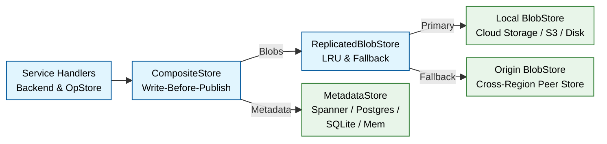
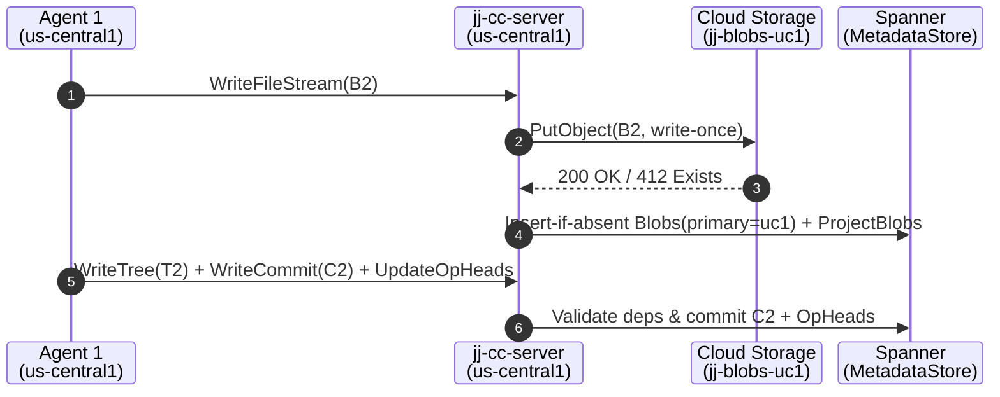
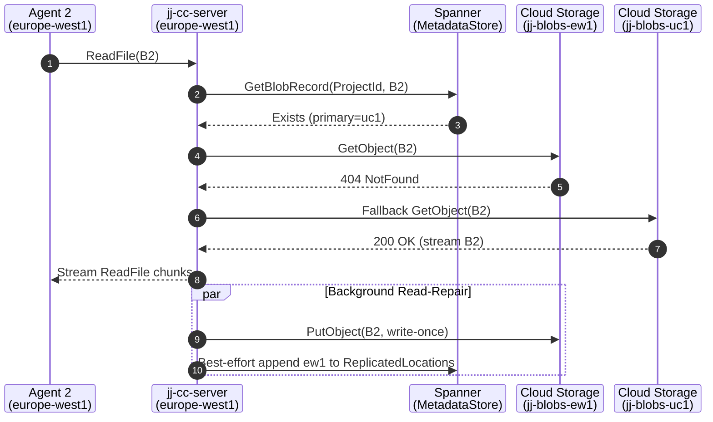

# Cloud Spanner and Cloud Storage Architecture for jj-commit-cloud

## Summary

jj-commit-cloud separates server persistence into two asynchronous storage traits: `MetadataStore` for transactional graph state and `BlobStore` for content-addressed file byte streams. Production backends pair [Cloud Spanner](https://cloud.google.com/spanner) with [Cloud Storage](https://cloud.google.com/storage) for multi-region deployments, or [PostgreSQL](https://www.postgresql.org/) 17 (`PostgresMetadataStore`) with S3-compatible object storage (`S3BlobStore`) for self-hosted deployments. [SQLite](https://www.sqlite.org/), local filesystem, and in-memory adapters support single-binary development and testing.

* **Multi-Repository Metadata Persistence:** Cloud Spanner and containerized [Spanner Omni](https://cloud.google.com/products/spanner/omni) host any number of repositories on one cluster, covering both unrelated codebases and sandboxes sharing history. They store commits, directory trees, symlinks, views, operation logs, and blob location records with external consistency across regions.
* **Immutable Blob Persistence:** Cloud Storage stores content-addressed file payloads keyed by digest (`blobs/<aa>/<bb>/<hex>`). Write-once preconditions (`if_generation_match` set to $0$) turn concurrent uploads of identical files into idempotent no-ops without triggering per-object overwrite rate limits, and immutable `Cache-Control` headers allow [Cloud CDN](https://cloud.google.com/cdn) and LAN caches to serve blobs without origin revalidation.
* **Cross-Region Replication-Lag Recovery:** Cloud Spanner transactions become visible worldwide in milliseconds, whereas cross-region Cloud Storage replication runs in the background. To close this gap, jj-commit-cloud completes `BlobStore` uploads before recording blobs or referencing trees in `MetadataStore`, and tracks origin locations (`PrimaryLocation` and `ReplicatedLocations`) in Spanner. When a regional bucket lags, readers fall back to the origin bucket with background read-repair. An opt-in bounded visibility retry (`GCS_REPLICATION_RETRY_MS`, default `0`) covers object stores without single-bucket read-after-write consistency.
* **Git Hash Parity and Decoupled Evolution:** Milestone 1 computes and verifies 20-byte Git SHA-1 digests via [gitoxide](https://github.com/GitoxideLabs/gitoxide) so Git repositories round-trip without hash-translation tables. `BYTES(64)` keys and `Commit.external_ids` decouple storage from Git's flat Merkle format, letting future prolly-tree directories and tree deltas attach imported or post-hoc Git hashes following [Mononoke](https://github.com/facebookexperimental/mononoke)'s Bonsai model.

## Motivation and Scale Targets

Workloads driven by parallel coding agents, large monorepos, and binary assets exceed single-node storage capacity and expose cross-region read-after-write hazards when metadata and object stores are uncoordinated. The architecture targets three workload envelopes:

* **Concurrent Agents:** $1{,}000+$ coding agents on one repository generating $5\text{ million}$ to $10\text{ million}$ working-copy snapshot commits and operation transitions per day, at up to $50$ file writes per second per agent.
* **Interactive Latency:** Sub-$200\text{ ms}$ metadata checkout latency at under $50\text{ ms}$ network RTT, with over $80\%$ fewer remote roundtrips when the local caching daemon is active.
* **Large Trees and Binaries:** $100{,}000+$ entry directory trees alongside multi-gigabyte binary files. In Milestone 1, `WriteFileStream` buffers uploads up to 4 MiB in memory under a 256 MiB server-wide budget and spills larger uploads (or uploads arriving while memory permits are exhausted) to temporary files on disk up to a 512 MiB per-stream cap before write-before-publish.

Scaling [jj](https://github.com/jj-vcs/jj)'s [backend](https://github.com/jj-vcs/jj/blob/v0.43.0/lib/src/backend.rs), [operation store](https://github.com/jj-vcs/jj/blob/v0.43.0/lib/src/op_store.rs), and [operation heads store](https://github.com/jj-vcs/jj/blob/v0.43.0/lib/src/op_heads_store.rs) traits to multi-region deployments requires separating relational graph metadata from object storage while guaranteeing that an agent in `europe-west1` can check out a commit published milliseconds earlier in `us-central1`.

## Architecture and Storage Boundaries

### Separating Graph Metadata From File Byte Streams

Version control graph nodes and raw file contents have opposite access patterns. Commits, directory trees, views, and operation heads are compact structured records that need serializable multi-row transactions, secondary index lookups by `ChangeId`, and byte-range prefix scans. File payloads span kilobytes to gigabytes, never mutate once hashed, and stream directly through object storage and HTTP edge caches.

jj-commit-cloud splits server persistence in [server/src/store/mod.rs](../server/src/store/mod.rs) into `MetadataStore` and `BlobStore`, coordinated by `CompositeStore` behind [backend.proto](../common/proto/backend.proto) and [op_store.proto](../common/proto/op_store.proto) (see [System Design](design.md) and [Data Model](data-model.md) for the overall multi-repository model).

<!--
Diagram styling and update instructions:
- Uses compact Mermaid flowchart LR (12px font, tight spacing) showing jj-cc-server storage layers (#e1f5fe / #01579b for coordinators/wrappers, #e8f5e9 / #2e7d32 for storage backends).
- To update: edit the node or edge declarations below and preview the rendered Mermaid block in Markdown.
-->

`MetadataStore` owns project and repository registration, active operation heads, commits with topological generation numbers ($\max(\text{parent generation}) + 1$), directory trees, short UTF-8 symlink target paths, repository views, operation log nodes, blob ownership links (`ProjectBlobs`), and the global blob location registry (`Blobs`). Keeping symlink targets in `MetadataStore` avoids object-store roundtrips during tree walks while hashing targets as Git `blob` objects for 1:1 Git compatibility.

`BlobStore` owns immutable file payloads above `INLINE_BLOB_THRESHOLD_BYTES` (default `0`, so non-empty blobs go to `BlobStore` unless inline storage is enabled). Backends include [GcsBlobStore](../server/src/store/gcsblob/mod.rs) for Cloud Storage, [S3BlobStore](../server/src/store/s3blob/mod.rs) for S3-compatible stores (MinIO, Amazon S3, Cloudflare R2), [LocalFsBlobStore](../server/src/store/localblob.rs) for local disk, and an in-memory adapter. It exposes whole-object and native byte-range `ReadFile` reads so [jj-vfs](https://github.com/jj-vcs/jj-vfs) can hydrate file slices without fetching entire objects. Uploads via `WriteFileStream` buffer up to 4 MiB in memory under a 256 MiB server-wide budget; larger uploads, or uploads arriving while memory permits are exhausted, spill to temporary files on disk up to the 512 MiB per-stream cap before hashing and committing to `BlobStore`.

### Selecting Cloud Spanner for Global Metadata

Multi-region agent fleets need a metadata store where an operation-head advance or blob origin record committed in one region is visible to global readers without replica lag or manual sharding:

| Property | Cloud Spanner & Spanner Omni | PostgreSQL 17 (`PostgresMetadataStore`) | SQLite (`WAL` Mode) | In-Memory Store |
| :--- | :--- | :--- | :--- | :--- |
| **Multi-Region Consistency** | External consistency via TrueTime and Paxos | Single-region primary with row-level repository locks; async read replicas have lag | Single-host local disk | Single-process volatile RAM |
| **Horizontal Write Scaling** | Automatic range splits across UUID and digest keys | Pooled concurrent writers (`deadpool-postgres`); vertical scaling or manual sharding at extreme write QPS | Single writer per database file | Contended process memory; bounded by RAM |
| **Operational Footprint** | Managed cloud service or containerized Spanner Omni | Self-hosted or managed PostgreSQL (such as CloudNativePG) with advisory-locked auto-migration | Embedded library; zero external daemons | Zero setup |
| **Role in jj-commit-cloud** | Production multi-region store and Emulator target | Self-hosted and single-region production store (paired with `S3BlobStore` or Cloud Storage) | Default local persistent store for single-node dev | Unit test baseline |

### Spanner Table Layout and Wide-Directory Batching

Unbounded commit graphs and append-only operation histories are poor fits for parent-table interleaving in Cloud Spanner: co-locating millions of commits or trees under a single `Projects` row, or millions of historical operations under a hot `Repositories` row, builds oversized parent subtrees and mixes cold history with mutable `OpHeads` writes while adding no benefit for point lookups by object ID. The GoogleSQL schema in [server/sql/spanner_schema.sql](../server/sql/spanner_schema.sql) keeps object and history tables as independent top-level tables with scope-first keys and interleaves only bounded parent-child pairs read together:

* **Top-Level Project Object Tables:** `Projects(ProjectId)` stores project metadata, while `Commits(ProjectId, CommitId)`, `Trees(ProjectId, TreeId)`, `Symlinks(ProjectId, SymlinkId)`, and `ProjectBlobs(ProjectId, BlobId)` are independent top-level tables grouped by `ProjectId` so repositories bound to the same project share one deduplicated pool while Spanner splits each large table on its own (dividing a large project's key range along the hash-distributed digest suffix).
* **Top-Level Repository and History Tables:** `Repositories(RepoId)` is keyed by UUIDv4 `RepoId` so high-frequency `OpHeads` transitions spread across splits, while `Operations(RepoId, OperationId)` and `Views(RepoId, ViewId)` remain independent top-level tables. `Blobs(BlobId)` stays top-level for global content-size and replica tracking.
* **Selective Interleaving:** `TreeEntries(ProjectId, TreeId, Name)` interleaves in `Trees` (`ON DELETE CASCADE`) so reading a directory scans contiguous rows in UTF-8 name order, and `Workspaces(RepoId, UserEmail, WorkspaceName)` interleaves in `Repositories` (`ON DELETE CASCADE`) to keep each repository's bounded checkout list co-located with its parent record.

Because Cloud Spanner caps a single transaction at 80,000 cell mutations, directories up to 4,000 entries commit `Trees` (`Ready = TRUE`) and all `TreeEntries` in one batch, while wider directories stage `Ready = FALSE`, stream 4,000-entry batches under the mutation ceiling, and flip `Ready = TRUE` on the final batch so interrupted writes never expose partial directories.

Short hex prefixes on commits and operations convert into inclusive binary bounds $[a, b]$ over `BYTES(64)` primary keys ($a \le \mathit{Id} \le b$, `LIMIT 2`), resolving `SingleMatch`, `AmbiguousMatch`, or `NoMatch` in one bounded range scan without extra string columns.

### Lock-Free Operation-Head Concurrency

Naive read-then-write updates to `OpHeads` drop concurrent work when two agents advance from the same base operation. Consider two agents attached to one repository starting from $[O_1]$:

1. Agent A writes view $V_2$ and operation $O_2$ (parent $O_1$) and calls `UpdateOpHeads` with $\mathit{old} = [O_1]$ and $\mathit{new} = O_2$. Inside a Spanner read-write transaction, `OpHeads` transitions from $[O_1]$ to $[O_2]$.
2. Agent B writes view $V_3$ and operation $O_3$ (also parent $O_1$) in parallel and calls `UpdateOpHeads` with $\mathit{old} = [O_1]$ and $\mathit{new} = O_3$. Inside a serializable read-write transaction, `SpannerMetadataStore` reads $[O_2]$, removes any entries in $\mathit{old}$, preserves the concurrent sibling $O_2$, and appends $O_3$, committing $[O_2, O_3]$.
3. If Spanner aborts one of the contending transactions, `TransactionRunner` retries the closure against the updated row state.
4. On the next repository access, `ReconcileOpHeads` in [server/src/reconcile_op_heads/mod.rs](../server/src/reconcile_op_heads/mod.rs) merges $V_2$ and $V_3$ into $O_4$ and swaps the pinned head snapshot $[O_2, O_3] \to [O_4]$ via serializable compare-and-swap (`ServerOpHeadsStore::with_expected_heads` backed by `compare_and_swap_op_heads`). When cross-branch commit rewrites or abandonments need client-side descendant rebasing, it returns `client_resolution_required`.

## Resolving Cloud Storage Replication Delays

### Cross-Region Consistency Skew Between Spanner and Cloud Storage

Pairing externally consistent metadata in Cloud Spanner with asynchronous object replication in Cloud Storage introduces a read-after-write window: a commit written in `us-central1` becomes visible in Spanner worldwide within milliseconds, before background replication copies its newly uploaded file blobs to `europe-west1`.

| Option | Foreground Write Latency | Cross-Region Read Behavior During Lag | Bandwidth & Cost Profile | Trade-Off Summary |
| :--- | :--- | :--- | :--- | :--- |
| **Option A: Synchronous Multi-Region Dual-Write** | High (every snapshot waits on slowest WAN bucket) | Immediate local hit; writes fail if any peer region is degraded | $N\times$ WAN egress on every intermediate snapshot | Slows interactive snapshots and couples write availability across regions |
| **Option B: Blind Retry Loop on Cloud Storage `404`** | Low (writes to local regional bucket) | Stalls across multi-minute replication windows; wastes retries on missing hashes | Low storage cost; high tail latency | Cannot bridge multi-minute lag; amplifies load on missing objects |
| **Option C: Spanner Origin Registry + Origin Fallback & Read-Repair (Chosen)** | Low (writes to local regional bucket, then commits Spanner row) | Immediate WAN fallback to `PrimaryLocation` on local `404` plus background read-repair | Zero WAN egress on local hits; cross-region fetch only on cold lag misses | Records `PrimaryLocation` and `ReplicatedLocations` on `Blobs` in Spanner |

### Cross-Region Walkthrough

Suppose Agent 1 in `us-central1` modifies `src/lib.rs` (producing file blob $B_2$ and tree $T_2$ in commit $C_2$) and Agent 2 in `europe-west1` checks out $C_2$ five milliseconds later:

1. Agent 1 streams `src/lib.rs` ($B_2$) to jj-cc-server in `us-central1`, which uploads $B_2$ to `gs://jj-blobs-uc1` and records `PrimaryLocation = "gs://jj-blobs-uc1"` in `Blobs` plus `ProjectBlobs` in Spanner before writing $T_2$, $C_2$, and `UpdateOpHeads`.
2. Five milliseconds later, before `gs://jj-blobs-ew1` has received $B_2$, Agent 2 in `europe-west1` reads $C_2$ and $T_2$ from Spanner and requests $B_2$ from its local `europe-west1` server.
3. The `europe-west1` server verifies `ProjectBlobs` in Spanner, sees `PrimaryLocation = "gs://jj-blobs-uc1"`, checks local bucket `gs://jj-blobs-ew1` (`404 NotFound`), fetches $B_2$ directly from `gs://jj-blobs-uc1`, streams it to Agent 2, caches it in memory, and repairs `gs://jj-blobs-ew1` in the background.

<!--
Diagram styling and update instructions:
- Uses compact Mermaid sequenceDiagram (12px font, reduced actor height and margins) with short message labels to keep both width and height small.
- To update: edit the sequence steps below and preview the rendered Mermaid block in Markdown.
-->

<!--
Diagram styling and update instructions:
- Uses compact Mermaid sequenceDiagram (12px font, reduced actor height and margins) with short message labels to keep both width and height small.
- To update: edit the sequence steps below and preview the rendered Mermaid block in Markdown.
-->

## Quality Attributes

### Crash Safety and Write-Before-Publish Ordering

Exposing a commit, tree, or blob metadata record before its underlying bytes finish uploading would surface broken references to readers. `CompositeStore` writes blobs to `BlobStore` before recording metadata rows and validates child blobs, symlinks, subtrees, parent commits, views, and operations before publishing parent entities.

### Tail Latency, Singleflight Coalescing, and Inline Small Files

Cold cross-region checkouts often trigger parallel reads of shared build and configuration files across dozens of agents. `ReplicatedBlobStore` pairs a byte-bounded in-memory LRU cache with per-digest singleflight coalescing so concurrent local misses on the same `BlobId` issue a single origin fetch and fan the resulting bytes out to all waiting callers. Small files up to `INLINE_BLOB_THRESHOLD_BYTES` can also live inline in `Blobs.InlineContent` to skip object-store roundtrips; this setting defaults to `0` (opt-in for non-empty blobs, with only 0-byte empty blobs stored inline by default).
