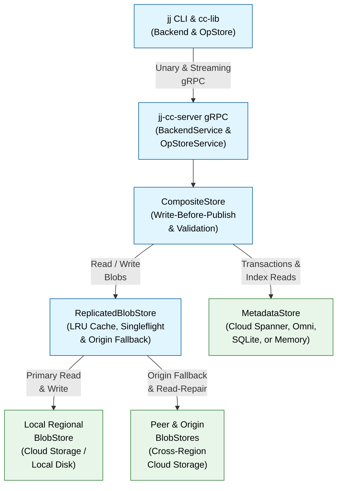
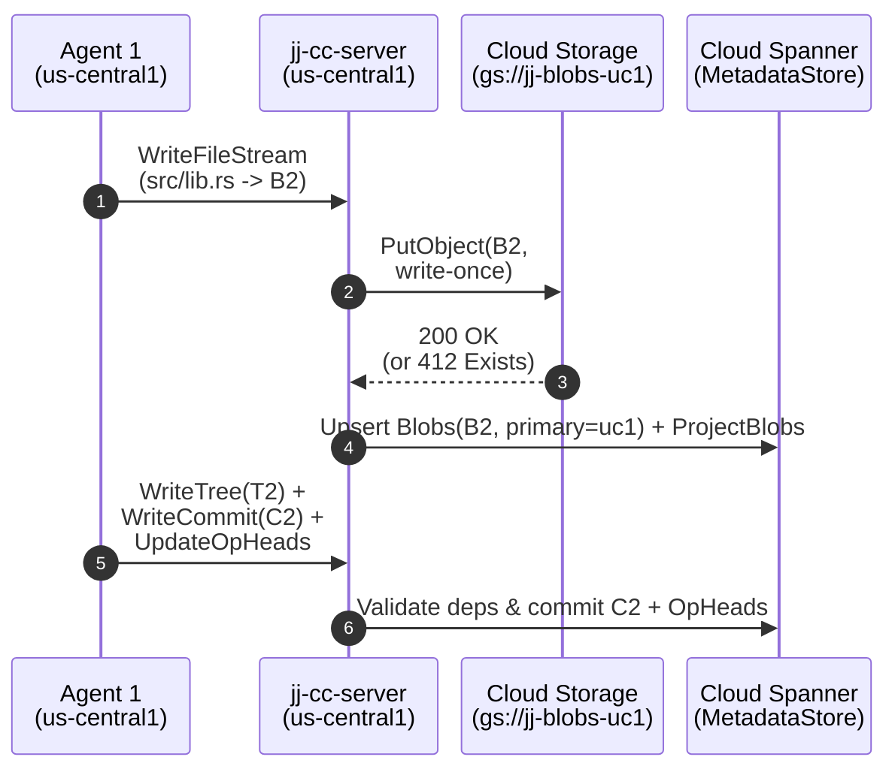
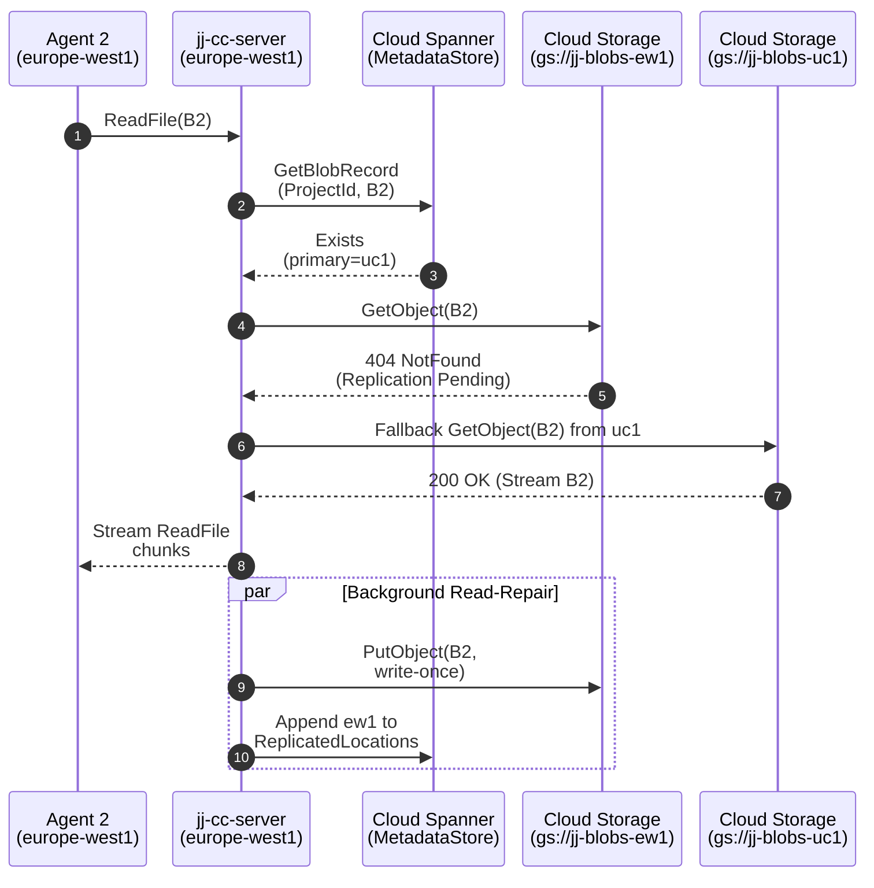

# Cloud Spanner and Cloud Storage Architecture for jj-commit-cloud

## Summary

jj-commit-cloud separates server persistence into two asynchronous storage traits - `MetadataStore` for transactional version control graph state and `BlobStore` for content-addressed file byte streams - backed by [Cloud Spanner](https://cloud.google.com/spanner) and [Cloud Storage](https://cloud.google.com/storage) for multi-region scale alongside [SQLite](https://www.sqlite.org/), local filesystem, and in-memory adapters for single-binary development and testing.

* **Multi-Repository Metadata Persistence:** Cloud Spanner (and containerized [Spanner Omni](https://cloud.google.com/products/spanner/omni) for on-premises, multi-cloud, and local deployments) hosts any number of repositories on one cluster - including unrelated codebases with disjoint commit graphs and sandboxes sharing history - storing commits, directory trees, symlinks, views, operation logs, and blob location records with external consistency across regions.
* **Immutable Blob Persistence:** Cloud Storage stores content-addressed file payloads keyed by digest (`blobs/<aa>/<bb>/<hex>`). Write-once preconditions (`if_generation_match` set to $0$) turn concurrent uploads of identical files into idempotent no-ops without triggering per-object overwrite rate limits, and immutable `Cache-Control` headers allow [Cloud CDN](https://cloud.google.com/cdn) and LAN caches to serve blobs without origin revalidation.
* **Cross-Region Replication-Lag Recovery:** Cloud Spanner transactions become visible worldwide in milliseconds, whereas cross-region Cloud Storage replication runs asynchronously in the background. jj-commit-cloud closes this visibility gap through write-before-publish ordering (`BlobStore` uploads complete before `MetadataStore` records the blob or any referencing tree), Spanner-tracked origin locations (`PrimaryLocation` and `ReplicatedLocations`), automatic fallback from a lagging regional bucket to the origin bucket with background read-repair, and bounded retry on single-endpoint multi-region buckets.
* **Git Hash Parity and Decoupled Evolution:** Milestone 1 computes and verifies 20-byte Git SHA-1 digests via [gitoxide](https://github.com/GitoxideLabs/gitoxide) so Git repositories round-trip without hash-translation tables, while `BYTES(64)` keys and `Commit.external_ids` decouple physical storage from Git's flat Merkle format so future prolly-tree directories and tree deltas can attach imported or post-hoc Git hashes following [Mononoke](https://github.com/facebookexperimental/mononoke)'s Bonsai model.

## Motivation and Scale Targets

Workloads driven by fleets of parallel coding agents, large monorepos, and distributed binary assets exceed single-node storage capacity and expose cross-region read-after-write hazards when metadata and object stores are left uncoordinated. The architecture targets $1{,}000+$ concurrent coding agents against one repository generating $5\text{ million}$ to $10\text{ million}$ working-copy snapshot commits and operation transitions per day (up to $50$ file writes per second per agent), sub-$200\text{ ms}$ metadata checkout latency at under $50\text{ ms}$ network RTT (paired with over $80\%$ fewer remote roundtrips when the local caching daemon is active), and $100{,}000+$ entry directory trees alongside multi-gigabyte binary files.

Scaling [jj](https://github.com/jj-vcs/jj)'s [backend](https://github.com/jj-vcs/jj/blob/v0.43.0/lib/src/backend.rs), [operation store](https://github.com/jj-vcs/jj/blob/v0.43.0/lib/src/op_store.rs), and [operation heads store](https://github.com/jj-vcs/jj/blob/v0.43.0/lib/src/op_heads_store.rs) traits to multi-region deployments requires separating relational graph metadata from object storage while guaranteeing that an agent in `europe-west1` can check out a commit published milliseconds earlier in `us-central1`.

## Architecture and Storage Boundaries

### Separating Graph Metadata From File Byte Streams

Version control graph nodes and raw file contents have opposite access patterns. Commits, directory trees, views, and operation heads are compact structured records that need serializable multi-row transactions, secondary index lookups by `ChangeId`, and byte-range prefix scans. File payloads span kilobytes to gigabytes, never mutate once hashed, and stream directly through object storage and HTTP edge caches.

jj-commit-cloud splits server persistence in [server/src/store/mod.rs](../server/src/store/mod.rs) into `MetadataStore` and `BlobStore`, coordinated by `CompositeStore` behind [backend.proto](../common/proto/backend.proto) and [op_store.proto](../common/proto/op_store.proto) (see [System Design](design.md) and [Data Model](data-model.md) for the overall multi-repository model).

<!--
Diagram styling and update instructions:
- Uses Mermaid flowchart TD with quoted node labels,   line breaks that keep the diagram within the page width, and standard palette classes (#e1f5fe fill, #01579b border for active components; #e8f5e9 fill, #2e7d32 border for storage backends).
- To update: edit the node or edge declarations below and run `jj fix -s @`.
-->

`MetadataStore` owns project and repository registration, active operation heads, commits with topological generation numbers ($\max(\text{parent generation}) + 1$), directory trees, short UTF-8 symlink target paths, repository views, operation log nodes, blob ownership links (`ProjectBlobs`), and the global blob location registry (`Blobs`). Keeping symlink targets in `MetadataStore` avoids object-store roundtrips during tree walks while hashing targets as Git `blob` objects for 1:1 Git compatibility.

`BlobStore` owns immutable file payloads above the inline size threshold, exposing whole-object and byte-range reads so [jj-vfs](https://github.com/jj-vcs/jj-vfs) can hydrate partial file slices on demand without buffering whole files in memory.

### Selecting Cloud Spanner for Global Metadata

Multi-region agent fleets need a metadata store where an operation-head advance or blob origin record committed in one region is immediately visible to global readers without replica lag or manual sharding:

| Property | Cloud Spanner & Spanner Omni | SQLite (`WAL` Mode) | Regional Primary/Replica SQL | In-Memory Store |
| :--- | :--- | :--- | :--- | :--- |
| **Multi-Region Consistency** | External consistency via TrueTime and Paxos | Single-host local disk | Asynchronous read replicas; failover lag | Single-process volatile RAM |
| **Horizontal Write Scaling** | Automatic range splits across UUID and digest keys | Single writer per database file | Manual sharding once write QPS saturates primary | Contended process memory; bounded by RAM |
| **Operational Footprint** | Managed cloud service or containerized Spanner Omni | Embedded library; zero external daemons | Connection pooling and failover orchestration | Zero setup |
| **Role in jj-commit-cloud** | Production multi-region store and Emulator target | Default local persistent store for single-node dev | Extension path via `MetadataStore` trait | Unit test baseline |

### Interleaved Spanner Schema and Wide-Directory Batching

Sequential keys or unco-located child tables create tablet hotspots and scatter directory reads across splits. The GoogleSQL schema in [server/sql/spanner_schema.sql](../server/sql/spanner_schema.sql) groups tables by access locality:

* **Shared Project Graph Root (`Projects(ProjectId)`):** Interleaves `Commits`, `Trees`, `TreeEntries`, `Symlinks`, and `ProjectBlobs` (`ON DELETE CASCADE`) so all repositories bound to a project share one deduplicated pool of immutable commits, trees, and file reachability records while unrelated projects partition cleanly across splits.
* **Per-Repository Coordination Root (`Repositories(RepoId)`):** Keys `Repositories` by UUIDv4 `RepoId` and interleaves `Views`, `Operations`, and `Workspaces` (`ON DELETE CASCADE`) so high-frequency `OpHeads` and workspace updates spread across independent Spanner splits without hotspotting, while `Blobs(BlobId)` remains top-level for global content-size and replica tracking.

`TreeEntries(ProjectId, TreeId, Name)` interleaves directly under `Trees` so reading a directory scans contiguous rows in UTF-8 name order. Because Cloud Spanner caps a single transaction at 80,000 cell mutations, directories up to 4,000 entries commit `Trees` (`Ready = TRUE`) and all `TreeEntries` in one batch, while wider directories stage `Ready = FALSE`, stream 4,000-entry batches under the mutation ceiling, and flip `Ready = TRUE` on the final batch so interrupted writes never expose partial directories.

Short hex prefixes on commits and operations convert into inclusive binary bounds $[a, b]$ over `BYTES(64)` primary keys ($a \le \mathit{Id} \le b$, `LIMIT 2`), resolving `SingleMatch`, `AmbiguousMatch`, or `NoMatch` in one bounded range scan without extra string columns.

### Lock-Free Operation-Head Concurrency

Naive read-then-write updates to `OpHeads` drop concurrent work when two agents advance from the same base operation. Consider two agents attached to one repository starting from $[O_1]$:

1. Agent A writes view $V_2$ and operation $O_2$ (parent $O_1$) and calls `UpdateOpHeads` with $\mathit{old} = [O_1]$ and $\mathit{new} = O_2$. Inside a Spanner read-write transaction, `OpHeads` transitions from $[O_1]$ to $[O_2]$.
2. Agent B concurrently writes view $V_3$ and operation $O_3$ (also parent $O_1$) and calls `UpdateOpHeads` with $\mathit{old} = [O_1]$ and $\mathit{new} = O_3$. Inside a serializable read-write transaction, `SpannerMetadataStore` reads $[O_2]$, removes any entries in $\mathit{old}$, preserves the concurrent sibling $O_2$, and appends $O_3$, committing $[O_2, O_3]$.
3. If Spanner aborts one of the contending transactions, `TransactionRunner` retries the closure against the updated row state automatically.
4. On the next repository access, jj-cc-server via `ReconcileOpHeads` in [server/src/reconcile_op_heads.rs](../server/src/reconcile_op_heads.rs) merges $V_2$ and $V_3$ into $O_4$ and swaps $[O_2, O_3] \to [O_4]$ via serializable compare-and-swap.

## Resolving Cloud Storage Replication Delays

### Cross-Region Consistency Skew Between Spanner and Cloud Storage

Pairing externally consistent metadata in Cloud Spanner with asynchronous object replication in Cloud Storage introduces a read-after-write window: a commit written in `us-central1` becomes visible in Spanner worldwide within milliseconds, before background replication copies its newly uploaded file blobs to `europe-west1`.

| Option | Foreground Write Latency | Cross-Region Read Behavior During Lag | Bandwidth & Cost Profile | Trade-Off Summary |
| :--- | :--- | :--- | :--- | :--- |
| **Option A: Synchronous Multi-Region Dual-Write** | High (every snapshot waits on slowest WAN bucket) | Immediate local hit; writes fail if any peer region is degraded | $N\times$ WAN egress on every intermediate snapshot | Slows interactive snapshots and couples write availability across regions |
| **Option B: Blind Retry Loop on Cloud Storage `404`** | Low (writes to local regional bucket) | Stalls across multi-minute replication windows; wastes retries on missing hashes | Low storage cost; high tail latency | Cannot bridge multi-minute lag; amplifies load on missing objects |
| **Option C: Spanner Origin Registry + Origin Fallback & Read-Repair (Chosen)** | Low (writes to local regional bucket, then commits Spanner row) | Immediate WAN fallback to `PrimaryLocation` on local `404` plus background read-repair | Zero WAN egress on local hits; cross-region fetch only on cold lag misses | Records `PrimaryLocation` and `ReplicatedLocations` on `Blobs` in Spanner |

### Cross-Region Walkthrough

Suppose Agent 1 in `us-central1` modifies `src/lib.rs` (producing file blob $B_2$ and tree $T_2$ in commit $C_2$) and Agent 2 in `europe-west1` checks out $C_2$ five milliseconds later:

1. Agent 1 streams `src/lib.rs` ($B_2$) to jj-cc-server in `us-central1`, which uploads $B_2$ to `gs://jj-blobs-uc1` and records `PrimaryLocation = "gs://jj-blobs-uc1"` in `Blobs` plus `ProjectBlobs` in Spanner before writing $T_2$, $C_2$, and `UpdateOpHeads`.
2. Five milliseconds later - before `gs://jj-blobs-ew1` has received $B_2$ - Agent 2 in `europe-west1` reads $C_2$ and $T_2$ from Spanner and requests $B_2$ from its local `europe-west1` server.
3. The `europe-west1` server verifies `ProjectBlobs` in Spanner, sees `PrimaryLocation = "gs://jj-blobs-uc1"`, checks local bucket `gs://jj-blobs-ew1` (`404 NotFound`), fetches $B_2$ directly from `gs://jj-blobs-uc1`, streams it to Agent 2, caches it in memory, and repairs `gs://jj-blobs-ew1` in the background.

<!--
Diagram styling and update instructions:
- Uses Mermaid sequenceDiagram with   line breaks in participant labels and messages to keep horizontal width compact; the init directive narrows participant boxes and margins so every participant fits the page width.
- To update: edit the sequence steps below and run `jj fix -s @`.
-->

<!--
Diagram styling and update instructions:
- Uses Mermaid sequenceDiagram with   line breaks in participant labels and messages to keep horizontal width compact; the init directive narrows participant boxes and margins so every participant fits the page width.
- To update: edit the sequence steps below and run `jj fix -s @`.
-->

## Quality Attributes

### Crash Safety and Write-Before-Publish Ordering

Exposing a commit, tree, or blob metadata record before its underlying bytes finish uploading would surface broken references to readers. `CompositeStore` writes blobs to `BlobStore` before recording metadata rows and validates child blobs, symlinks, subtrees, parent commits, views, and operations before publishing parent entities.

### Tail Latency, Singleflight Coalescing, and Inline Small Files

Cold cross-region checkouts often trigger parallel reads of shared build and configuration files across dozens of agents. `ReplicatedBlobStore` pairs a byte-bounded in-memory LRU cache with per-digest singleflight coalescing so concurrent local misses on the same `BlobId` issue a single origin fetch and fan the resulting bytes out to all waiting callers, while tiny files stay inline in `Blobs.InlineContent` to avoid object-store roundtrips altogether.
